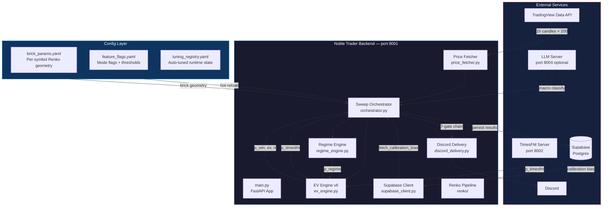
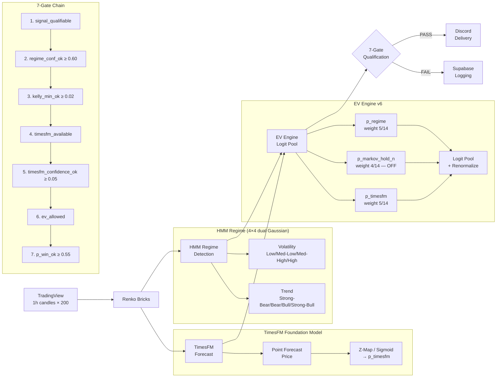
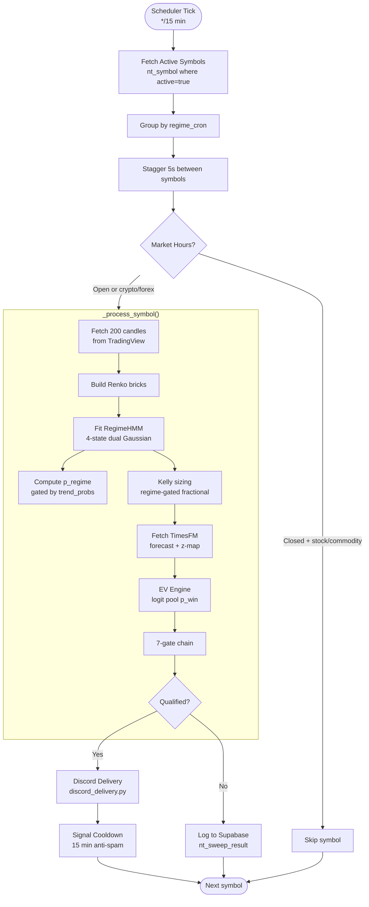
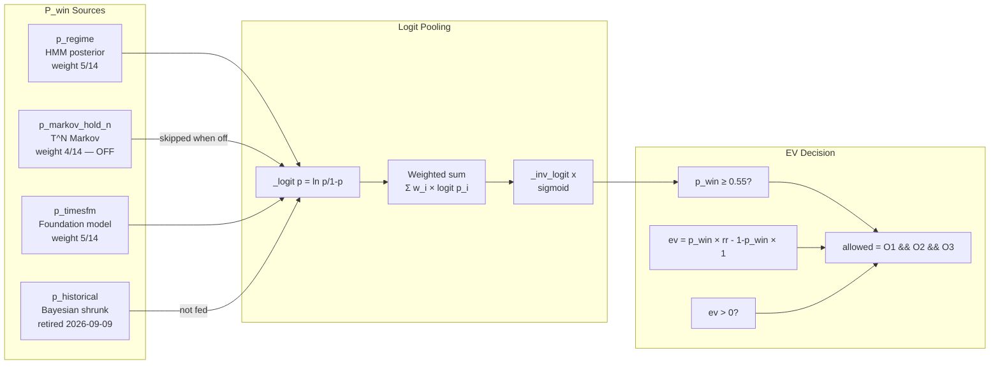
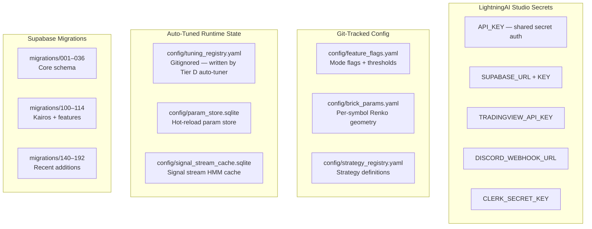
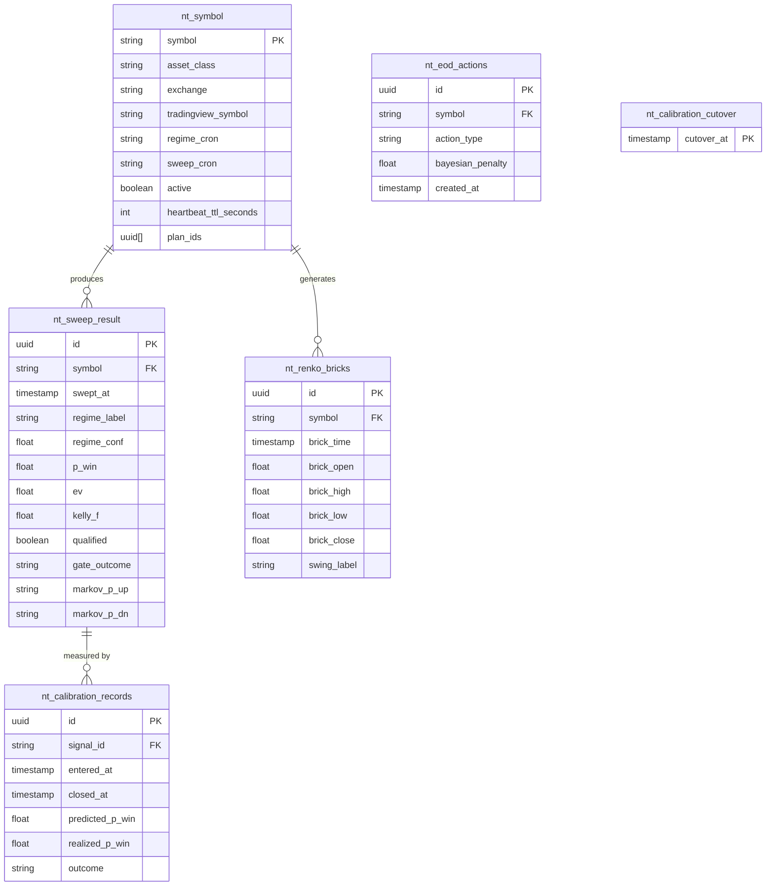
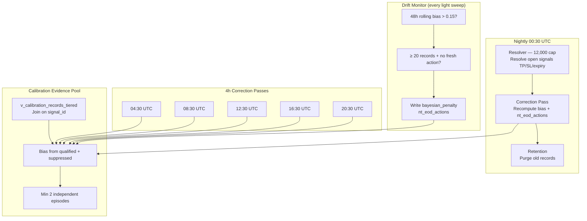

# noble-trader-fastapi-backend — Wiki

> **Codename:** Kairos (καιρός — *the opportune moment*)
> **Version:** v8.2.0 · **Updated:** 2026-10-11
> **Role:** Sweep orchestrator / signal producer on LightningAI Studio

---

## Table of Contents

1. [Overview](#overview)
2. [Architecture](#architecture)
3. [Signal Pipeline](#signal-pipeline)
4. [Sweep Orchestrator](#sweep-orchestrator)
5. [EV Engine](#ev-engine)
6. [Configuration](#configuration)
7. [Supabase Schema](#supabase-schema)
8. [EOD Recalibration Loop](#eod-recalibration-loop)
9. [Key Modules](#key-modules)
10. [Testing & Verification](#testing--verification)
11. [Known Pitfalls](#known-pitfalls)
12. [Worklog & Changelog](#worklog--changelog)

---

## Overview

Noble Trader FastAPI Backend is a **sweep orchestrator and signal producer** that consumes market data, runs it through a multi-modal AI pipeline (HMM regime detection + TimesFM forecasting), and emits qualified trading signals via Discord.

The system runs on **LightningAI Studio** as a 3-layer stack:

| Layer | File | Port | Responsibility |
|-------|------|------|----------------|
| Main API | `main.py` | 8001 | HMM regime detection, Renko pipeline, auth, all REST/WebSocket routes |
| TimesFM | `server.py` | 8002 | TimesFM foundation model forecast server |
| Proxy | `proxy.py` | 8000 | Public gateway / reverse proxy |
| LLM (opt.) | `llm_server.py` | 8004 | Local instruct LLM for macro classification |

**Sweep cadence:**

| Sweep | Frequency | Symbols | Purpose |
|-------|-----------|---------|---------|
| Light | Every 15 min | 14 | Signal generation / qualification |
| Heavy | Daily 20:00 UTC | 14 | Grid search + brute-force optimization |

---

## Architecture



---

## Signal Pipeline

The core signal generation pipeline flows through 7 gates before a signal is published:



### Gate Details

| Gate | Threshold | Config Key | Blocking? |
|------|-----------|------------|-----------|
| 1. `signal_qualifiable` | — | — | Yes |
| 2. `regime_conf_ok` | ≥ 0.60 | `qualification_gates.min_regime_conf` | Yes |
| 3. `kelly_min_ok` | ≥ 0.02 | `qualification_gates.min_kelly` | Yes |
| 4. `timesfm_available` | — | — | Yes |
| 5. `timesfm_confidence_ok` | ≥ 0.05 | `qualification_gates.min_timesfm_confidence` | Yes |
| 6. `ev_allowed` | ev > 0 and rr ≥ 1.5 | `min_ev`, `min_rr` | Yes |
| 7. `p_win_ok` | ≥ 0.55 | `qualification_gates.min_p_win` | Yes |

> **Note:** `min_rr` is shared but empirically inert on the light path (typical brick geometries already sit at RR ≈ 1.67–2.0+). Do **not** raise it to 2.0 expecting tighter quality — that is a geometry choke, not a quality filter.

---

## Sweep Orchestrator

The orchestrator (`regime_platform/sweep_orchestrator/orchestrator.py`, ~6,090 lines) is the heart of the system:



### Stale Symbol Recovery

A 60-second background loop re-processes any symbol whose last successful sweep is older than 20 minutes (`STALE_THRESHOLD_S = 1200`). This catches symbols that were temporarily unavailable (market closed, API throttled).

### Scheduler Cadence

| Cron | Job | Action |
|------|-----|--------|
| `*/15 * * * *` | Light sweep | Full 7-gate qualification for all 14 symbols |
| `0 20 * * *` | Heavy sweep (`nt_symbol.sweep_cron`) | Grid search + brute-force optimization |
| `0 0 * * *` | EOD resolver | Resolve open signals (TP/SL/expiry) |
| `*/4 * * * *` | 4h correction passes | Recompute bias + `nt_eod_actions` at 04:30/08:30/12:30/16:30/20:30 UTC |
| `30 0 * * *` | Nightly recalibration | Resolver (12,000 cap) + correction + retention |

---

## EV Engine

The EV Engine (`regime_platform/services/statistics/ev_engine.py`) computes a blended win probability via logit pooling:



### Weight Renormalization

When a source is unavailable, the engine renormalizes the remaining weights to sum to 1.0:

| Available Sources | Weights |
|-------------------|---------|
| All 3 (regime + markov + timesfm) | 5/14, 4/14, 5/14 |
| Regime + timesfm only (markov off) | 5/10, —, 5/10 |
| Regime only | 1.0, —, — |
| Timesfm only | —, —, 1.0 |

### Markov Chain Parameters

| Parameter | Default | Env Override | Description |
|-----------|---------|-------------|-------------|
| Rolling window | 7 days | `MARKOV_WINDOW_DAYS` | Transition matrix estimation window |
| Bars per day | 24 | `MARKOV_BARS_PER_DAY` | 1h candles = 24 bars/day |
| Hold steps | 10 | `MARKOV_HOLD_STEPS` | T^N fallback (production uses `tp_bricks`) |

---

## Configuration

### Config Hierarchy



### Key Feature Flags

| Flag | Default | Effect |
|------|---------|--------|
| `markov_source_mode` | `legacy_hmm` | Which source feeds `p_markov_hold_n`'s 3×3 transition matrix |
| `p_markov_hold_n_mode` | `off` | Whether Markov participates in the EV blend |
| `ev_scale_sizing_mode` | `on` | Whether `ev_scale` multiplies position size |
| `timesfm_gate_mode` | `soft` | How TimesFM confidence affects qualification |
| `timesfm_map_mode` | `zmap_live` | Price→probability mapping method |
| `sweep_after_hours` | `false` | Sweep all symbols regardless of market hours |
| `signal_cooldown_minutes` | `15` | Anti-spam cooldown for repeat publishes |
| `eod_resolver_basis` | `intrabar` | TP/SL resolution basis (high/low vs close) |
| `calibration_cutover_mode` | `on` | Restrict calibration to post-cutover evidence |
| `price_staleness_max_hours` | `1.0` | Skip symbols with stale price data |

### Brick Parameters (`config/brick_params.yaml`)

Per-symbol Renko geometry:

```yaml
# Example structure
EURUSD:
  brick_size: 0.0005
  sl_bricks: 3      # 3 × brick_size = stop distance
  tp_bricks: 5      # 5 × brick_size = target distance
  # RR = tp_bricks / sl_bricks = 5/3 ≈ 1.67
```

> **⚠️ Critical:** `config/brick_params.yaml` is gitignored on purpose. Local checkout has **stale placeholder data** — never run `renko_retention.py` or brick-param-based scripts from a local checkout against prod. Run such scripts ON the Studio via SSH only.

---

## Supabase Schema



### Migration Convention

```
supabase/migrations/NNN_snake_name.sql
```

- `001–036`: Core schema (symbols, sweep results, calibration, Renko)
- `100–114`: Kairos feature additions
- `140–192`: Recent additions (EOD resolver, calibration pool, cutover)

### PostgREST Quirks

| Issue | Workaround |
|-------|------------|
| Filter values with `+` | Use `Z` not `+00:00` |
| Timestamp microseconds (`.`) | Conflict with PostgREST's `.` delimiter — use `.replace(microsecond=0)` |
| `limit=10000` silently capped at 1000 | Use offset-based pagination (`limit=1000&offset=N` loop) |

---

## EOD Recalibration Loop



### Rolling Bias Window

- **Lookback:** 7 days
- **Minimum records:** 20
- **Drift threshold:** 0.15 (48h rolling)
- **Episode grouping:** Records whose `[entered_at, closed_at]` windows overlap are one episode

---

## Key Modules

### Core (`regime_platform/core/`)

| Module | Lines | Purpose |
|--------|-------|---------|
| `regime_engine.py` | ~1,166 | 4-state dual GaussianHMM (volatility × trend) |
| `ev_engine.py` | ~1,024 | Logit-pooled P_win blend |
| `feature_flags.py` | ~1,976 | Hot-reload YAML config loader |
| `position_sizer.py` | — | Regime-gated fractional Kelly sizing |
| `settings.py` | — | Environment + Secret resolution |
| `runtime_config.py` | — | Runtime parameter store |
| `param_store.py` | — | SQLite-backed hot-reload params |

### Sweep Orchestrator (`regime_platform/sweep_orchestrator/`)

| Module | Size | Purpose |
|--------|------|---------|
| `orchestrator.py` | 317 KB | Core sweep loop, 7-gate chain, scheduler |
| `heavy_sweep.py` | 119 KB | Grid search + brute-force optimization |
| `eod_resolver.py` | 64 KB | Signal resolution (TP/SL/expiry) |
| `price_fetcher.py` | 19 KB | TradingView batch API client |
| `supabase_client.py` | 143 KB | Supabase REST wrapper |
| `tiered_atr.py` | 47 KB | Tiered ATR computation |
| `eod_correction.py` | 40 KB | 4h correction pass logic |
| `discord_delivery.py` | 4 KB | Direct Discord webhook delivery |
| `bracket_reachability.py` | 19 KB | Bracket reachability analysis |
| `calibration_enforcement.py` | 27 KB | Post-hoc calibration adjustment |
| `drift_monitor.py` | 6 KB | 48h rolling bias monitor |
| `first_passage.py` | 11 KB | First-passage time analysis |
| `reachability_prob.py` | 9 KB | Reachability probability |
| `market_hours.py` | 2 KB | Market open/close detection |

### Services (`regime_platform/services/`)

| Module | Purpose |
|--------|---------|
| `hmm/model.py` | Legacy 5-state HmmModel (numerically unstable, being replaced) |
| `statistics/ev_engine.py` | EV Engine v6 |
| `portfolio_service.py` | Multi-symbol aggregated regime + risk |
| `pnl_service.py` | PnL tracking |
| `alpaca_stream.py` | Alpaca WebSocket feed adapter |
| `l2_feed_manager.py` | L2 order book feed manager |
| `masaniello_bridge.py` | Masaniello sizing bridge |
| `backtest_store.py` | Backtest result storage |
| `data_quality.py` | Data quality checks |

### Routers (`regime_platform/routers/`)

| Router | Prefix | Purpose |
|--------|--------|---------|
| `regime.py` | `/regime` | HMM regime detection |
| `pipeline.py` | `/renko` | Renko HFT pipeline |
| `portfolio.py` | `/portfolio` | Multi-symbol portfolio |
| `risk.py` | `/risk` | VaR/CVaR/drawdown analysis |
| `sizing.py` | `/size` | Kelly + Masaniello sizing |
| `feeds.py` | `/feeds` | Feed adapter management |
| `calibration.py` | `/calibration` | Calibration records |
| `backtest.py` | `/backtest` | Isolated backtest runs |
| `stream_rest.py` | `/stream` | Streaming session management |
| `stream_ws.py` | `/ws` | WebSocket stream |
| `config.py` | `/config` | Runtime config |
| `prices.py` | `/api/price` | Price batch fetch |
| `observation.py` | `/observation` | 24-feature observation vector |
| `gpu.py` | `/gpu` | GPU HMM backend |
| `strategy.py` | `/strategy` | Strategy management |
| `pnl.py` | `/pnl` | PnL reporting |
| `simulate.py` | `/simulate` | Markov chain simulation |
| `tda.py` | `/tda` | TradingView Data API proxy |
| `venue.py` | `/venue` | Venue detection |
| `operational.py` | `/ops` | Operational endpoints |

---

## Testing & Verification

### Test Suite

```bash
# Full suite (always use this exact invocation)
PYTHONPATH="$PWD/src" ./.venv/Scripts/python.exe -m pytest tests/ -q -p no:cacheprovider

# Hermes verify (Windows-safe — start phase hangs on Windows)
hermes verify --json --skip-start
```

> **⚠️ Critical:** Always set `PYTHONPATH="$PWD/src"` to avoid shadowing the project venv. Plain `pytest` can hang on heavy backtest files.

### Version Consistency

Version anchors must be updated together on any bump:

| File | Contains |
|------|----------|
| `pyproject.toml` | `version = "X.Y.Z"` |
| `main.py` | `__version__ = "X.Y.Z"` |
| `openapi.yaml` (both copies) | `version: X.Y.Z` |
| `tests/test_version_consistency.py` | Asserts exact match |

---

## Known Pitfalls

### 1. TDVA Price Ordering (FIXED 2026-08-11)

`/api/price/batch` returns `history` **DESCENDING** (newest first). `prices.reverse()` in `price_fetcher.py` fixes this. A stale-price window (Aug 6–11T14:00Z) contaminated calibration records — 14,248 deleted, 2,953 clean retained.

### 2. MIN_RR Split (FIXED 2026-08-17, 2026-09-04)

Light EV allow and heavy grid pre-filter must read the **same** value. Today that value is `config/feature_flags.yaml` `min_rr: 1.5` via `get_min_rr()`. The 2026-08-17 split (hardcoded heavy 2.0 vs env 1.5) and the 2026-09-04 regression (yaml briefly shipped at 2.0) both show why a silent second source is dangerous.

> **2026-09-20 status:** At 1.5 the light RR clause is empirically inert — maintain the single source, do not reintroduce env overrides, do not "tighten to 2.0" on the light path as a quality lever.

### 3. p_markov_hold_n Withdrawn (2026-10-01)

The legacy 5-state HMM measured **below** the naive base rate (0.525 vs 0.5655) and is being replaced by first-passage (`tiered_atr.walk()`). It still fits each tick for `nt_sweep_result`'s legacy columns but no longer feeds the EV blend (`p_markov_hold_n_mode: "off"`). The blend is now `p_regime / p_timesfm` at 50/50.

### 4. pg_cron Trap

When `app.functions_url` setting is unset → `net.http_post` returns 404s. Verified fix: recreate cron with hardcoded function URL via `cron.schedule`.

### 5. Non-Superuser Cron

- `cron.schedule()` works (42501 on `cron.job` updates)
- `ALTER TYPE ADD VALUE` works
- `app.functions_url` unset causes `net.http_post` 404s — recreate cron with hardcoded function URL

---

## Worklog & Changelog

### Worklog Files

| Path | Scope |
|------|-------|
| `worklog/YYYYMMDD_*.md` | Daily changelogs and feature worklogs |
| `worklog/kairos/` | Kairos branch research (now merged to `main`) |
| `worklog/kairos/reports/` | Research reports (RM-1, G2 looks, etc.) |
| `worklog/kairos/scopes/` | Scope documents |
| `docs/scopes/` | Feature assessment scope docs |

### Recent Milestones

| Date | Milestone |
|------|-----------|
| 2026-08-06 | `fastapi-mcp` crash fixed (Render.com) |
| 2026-08-11 | TDVA price ordering fix |
| 2026-08-13 | Full EOD recalibration build |
| 2026-08-17 | Recalibration perf deep assessment + MIN_RR split fix |
| 2026-08-23 | HMM stability fixes (AAPL/US500 root cause) |
| 2026-08-25 | Markov shadow mode, API key auth, Discord direct delivery |
| 2026-08-30 | Config centralization (feature_flags.yaml) |
| 2026-09-04 | Kelly direction-aware sizing, MIN_RR regression fix |
| 2026-09-08 | Scheduler changed from weekly to daily heavy sweep |
| 2026-09-09 | p_historical retired from EV blend |
| 2026-09-15 | Two-week retrospective signal quality review |
| 2026-09-16 | TimesFM sigmoid/k/clamp env vars → feature_flags |
| 2026-09-25 | Restart-safe regime state, hourly calibration resolve |
| 2026-09-26 | Hourly calibration, evidence pool, resolver head-of-line fix |
| 2026-10-01 | HMM → first-passage research, p_markov_hold_n withdrawn |
| 2026-10-02 | Signal quality: 3 sizing fixes + 4 measurement instruments |

### Severity-Batch Auth

Backend fixes are authorized in severity batches:

```
critical → high → m1,m4,… (by id) → lows
```

Each batch must be independently verified (full pytest suite green + behavioral smoke) before reporting. The user then green-lights the next tier.

---

## Related Repos

| Repo | Role |
|------|------|
| `noble-trader-talaria` | Client plugin, tools, cron notifiers |
| `noble-trader-hermes-agent-profile` | Profile distribution (`NOBLE_STACK_ROOT` points here) |
| `noble-trader-proxy` | Retired 2026-08-25 (no replacement needed) |
| `nobletradingapp` | Clerk + Helio checkout, claim tokens, Edge Functions |

---

*This wiki is auto-generated from the codebase. Last verified against commit `ee74177`.*
