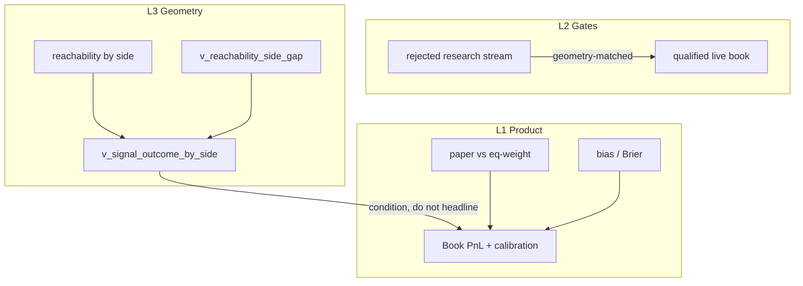

# Quality Measurement Layers Assessment (finished)

> **Date:** 2026-09-22 · **Mode:** assessment only (no code change)  
> **Directive:** EOD win% / expiry over all `nt_signal_sim` is **not** product quality.  
> Return to **L1 product → L2 gates → L3 geometry**. Buy vs sell is shown in the
> nobletradingapp pairs matrix (commentary symbols) and measured by migration 159
> side views.

---

## 0. Studio update / restart — log check

| Check | Result |
|---|---|
| Orchestrator | Healthy through 03:41 UTC. Light `*/15` + heavy `6 17 * * *`, 14 symbols refreshed. |
| `trend_probs_gate_mode` | **live** (python inspect + yaml). Post-restart (after 01:11) **0** `trend_probs gate shadow` log lines — live path is what runs. |
| `regime_label_debounce_mode` | **live**. Post-restart **0** `regime debounce shadow` lines. |
| `min_rr` | 1.5 (feature_flags.yaml; still inert on light path per 2026-09-20). |
| `markov_source_mode` | `trend_hmm_shadow` — comparison still logging as designed (legacy feeds blend). |
| `dynamic_min_rr_mode` | Shadow “would apply 1.50→2.00” logs only; superseded 2026-09-20. |
| `geometry_tuning_sweep_mode` | **live** — `geometry_tuning_sweep` writes present in EOD correction logs. |
| Gateway | One startup health probe printed `DOWN` (boot race). Live `gateway.log` is serving `/forecast` and `/health` 200s. Not a live outage. |

**Verdict:** studio restart landed the live gate flips correctly. Residual “shadow” strings in the log are markov-source / dynamic-RR, not the trend_probs/debounce gates.

---

## 1. Measurement model (why EOD is the wrong bar)

The platform intentionally produces a large research stream. Resolution mix over
that stream is a **geometry + simulator** diagnostic, not a product KPI.

| Layer | Question | Primary surfaces | Do **not** use as |
|---|---|---|---|
| **L1 Product** | Does the **book** make money? Is `p_win` honest? | `v_paper_equity`, `v_paper_positions`, `v_paper_vs_optimized_daily` (paper vs eq-weight **after unit alignment**), `v_eod_calibration_bias_latest` / Brier | raw win%, raw expiry% |
| **L2 Gates** | Do Kelly / regime / p_win gates add value? | qualified vs unqualified **on L3-matched geometry**; gate reject composition | all-resolved expire% as “product failure” |
| **L3 Geometry** | Can TP/SL be reached in 48h? | `nt_bracket_reachability` (signal buy\|sell\|all), `v_reachability_side_gap`, `v_signal_outcome_by_side` expire/TP/SL **as geometry** | product KPI without conditioning on bucket |

Identity to keep:  
`P(win) = P(resolve) × P(win | resolve)`  
and L1/L2 comparisons must hold **L3 (symbol, vol_tier, distance/ATR) fixed**.

---

## 2. L1 — Product (live numbers, 2026-09-22)

### Book PnL (`v_paper_equity`)
- Cumulative paper PnL: **+$246.39** on the $1,000 base (46 days).
- Daily mean +$5.36 is misleading: **median daily is −$1.03**, only **19/46 days** positive.
- **Last 10 days: −$34.01** (9 of 10 negative; only 09-21 +$9.84). Early-session gains are carrying the cumulative number.
- Open book: 10 open paper positions (~$200 notional each), mixed buy/sell.

### Paper vs equal-weight (`v_paper_vs_optimized_daily`) — **broken as currently defined**
| Metric | Value | Issue |
|---|---|---|
| `paper_pnl` sum | +$246 | Kelly-sized ~$200 notional book |
| `equal_wt_pnl` sum | **−$411,772** | `SUM(pnl_dollars)` over **entire research stream** (1-unit price delta × lots; e.g. BTC rows +$1,450) |
| `paper_minus_equal_wt` sum | +$412,018 | Not a real edge — units are not commensurate |
| days paper > eq | 29/46 | Dominated by the equal-wt blow-ups |

**Assessment:** `paper_minus_equal_wt` cannot serve as the L1 quality bar until both sides use the **same notional, same cohort (qualified book), same expired treatment**. Today it mostly says “the research stream is huge and unit-scaled differently.”

Also: `v_paper_vs_optimized_symbol` is structurally wrong — **457 rows** with `n_resolved=1` fragments. The `LEFT JOIN LATERAL` on `signal_id` groups per signal, not per symbol. Do not use it for allocation/value-add until rewritten as a true per-symbol aggregate.

### Calibration (`v_eod_calibration_bias_latest`)
| Symbol | n (episodes) | bias | status | realized win |
|---|---:|---:|---|---:|
| XAUUSD | 3 | +0.459 | OVERCONFIDENT | 0.11 |
| EURUSD | 5 | +0.452 | OVERCONFIDENT | 0.03 |
| XAGUSD | 2 | +0.376 | OVERCONFIDENT | 0.15 |
| BTCUSD | 2 | +0.362 | OVERCONFIDENT | 0.15 |
| USDJPY | 2 | +0.393 | OVERCONFIDENT | 0.08 |
| XAUAUD | 3 | +0.298 | CALIBRATED* | 0.22 |
| US30USD | 4 | +0.231 | CALIBRATED* | 0.23 |
| US500 | 3 | +0.049 | CALIBRATED | 0.49 |
| AAPL | 5 | −0.017 | CALIBRATED | 0.58 |
| (others) | 1–2 | mixed | INSUFFICIENT_DATA | — |

\*status thresholds still pass some +0.23–0.30 biases as CALIBRATED — review band.

**Product calibration verdict:** p_win is still systematically overconfident on gold/crypto/FX majors. AAPL/US500 are the only symbols that look honest on closed outcomes. This is the L1 quality problem, independent of win%/expiry mix.

### Scorecard dual-report (supporting, not product)
Qualified scorecard `pnl_closed_only` ≈ +$14.6k, `pnl_all_resolved` ≈ +$21.5k (1-unit notional units again — not the paper book). Use dual-report to show expired treatment sensitivity; do not headline either as book PnL.

---

## 3. L2 — Gates

What gates must answer: **does the qualified book beat the research stream after matching geometry?**

Live side totals from `v_signal_outcome_by_side` (migration 159):

| Cohort | Side | n | %TP | %SL | %Expired | win_closed |
|---|---|---:|---:|---:|---:|---:|
| **qualified=true (live book)** | buy | 575 | 13.6% | 30.6% | **55.8%** | **30.7%** |
| **qualified=true** | sell | 412 | 10.0% | 38.8% | **51.2%** | **20.4%** |
| qualified=false (research) | buy | 38,839 | 11.6% | 35.7% | 52.7% | 24.6% |
| qualified=false | sell | 30,439 | 15.1% | 36.0% | 48.9% | 29.6% |

**Assessment:**
1. Volume is intentional (research stream). All-resolved EOD mix is dominated by `qualified=false` and **inverts** the live-book side story (research sell wins more; live buy wins more).
2. Gates currently cannot be credited/blamed from raw mix: qualified book still expires ~52–56% because of **geometry** (below), not because gates “failed to pick winners.”
3. Correct L2 measure (not yet wired as one query): qualified vs unqualified **within the same `(symbol, vol_tier, distance_atr_bucket, signal)` cell**, reporting `P(resolve)` and `win_closed` separately.

---

## 4. L3 — Geometry (conditions everything)

### Why win% / expiry cannot be product KPIs
Qualified expiry is **symbol/geometry-dominated**:

| Symbol/side | n | %Expired | win_closed |
|---|---:|---:|---:|
| EURUSD sell | 21 | **100%** | — |
| USDJPY buy | 34 | **100%** | — |
| EURUSD buy | 73 | 97.3% | 0.50 |
| GBPUSD buy/sell | 52/26 | 96.2% | 0.00 |
| AUDUSD buy/sell | 93/38 | ~92% | 0.29 / 0.00 |
| XAGUSD buy | 19 | 5.3% | **0.78** |
| AAPL buy | 27 | 0.0% | 0.07 |
| BTCUSD buy | 74 | 16.2% | 0.58 |

Same platform, same gates class: FX majors with wide/low-touch brackets never resolve; silver/equity resolve. Headline “win% 30% / expire 55%” without this split is meaningless.

### Buy vs sell geometry (`v_reachability_side_gap`)
- 216 gap rows; **125** with both sides n≥10.
- Mean `tp_gap_buy_minus_sell` = **−0.041** (median −0.013) → slight **sell TP-reach** advantage in the pooled sample.
- Direction split: **45** buckets sell-better TP, **28** buy-better, **52** near zero.
- Extreme |tp_gap|>0.6 buckets often mirror SL (`tp_gap ≈ −sl_gap`) and/or thin n — classic **direction-asymmetric bracket geometry** (TP/SL measured on the wrong side of the brick) or regime-side bias, not raw edge.
- Examples: BTCUSD `med_high_vol 2-4` tp_gap −0.94 (nb=52,ns=39); AAPL `med_high_vol 4+` tp_gap −0.75 (nb=32,ns=112); XAGUSD `med_high_vol 1-2` tp_gap +0.86 (nb=7,ns=15).

**Assessment:** L3 already has the right keying (symbol × vol_tier × distance/ATR × side). Until L1/L2 are evaluated **inside** these cells, any win%/expiry ranking is confounded.

---

## 5. Buy vs sell — product demonstration (nobletradingapp pairs matrix)

**Product surface (already shipped):** Signal Risk overview → Concurrent-signal agreement  
(`nobletradingapp/app/dashboard/page.jsx` PairList + agreement matrix; backend `nobletradingapp-backend` `GET /webapp/signal-agreement`).

What it shows on **commentary / plan symbols**:
- Direction agreement (`buy=+1`, `sell=−1`) on days **both** symbols had a qualified signal (not price correlation).
- PairList cards: **Most redundant** (rate ≥ 0.7, same side almost always — acting on both ≈ one bet) vs **Most complementary** (rate ≤ 0.3, opposite sides — natural hedge).
- Read the same way as the correlation matrix: red = same direction; green = disagree.

**Measurement surfaces (migration 159):**
| Surface | Role |
|---|---|
| `v_signal_outcome_by_side` | TP/SL/expired + `win_pct_closed` by `(symbol, signal, qualified)` |
| `v_reachability_side_gap` | BUY−SELL gaps on TP/SL/expire by geometry bucket |
| `nt_bracket_reachability.signal` | `buy` \| `sell` \| `all` reach rows |
| `v_symbol_signal_scorecard` `GROUP BY signal` | dual-report closed-only vs all-resolved by side |

**Side read (qualified live book only):** buys close-win more (30.7% vs 20.4%) but expire slightly more; sells stop out more (38.8% SL). Research stream reverses the win_closed ranking — another reason not to score EOD mix over all rows.

---

## 6. Verdicts

| # | Claim | Verdict |
|---|---|---|
| Studio after update/restart | Live gates active; stack healthy | **PASS** (gateway boot-probe race only) |
| EOD win% / expiry as quality | Wrong measure — geometry + research volume dominate | **REJECT as product KPI** |
| L1 book PnL | Cum +$246 but last-10 −$34, median day negative | **MIXED / deteriorating short-window** |
| L1 paper vs eq-weight | Incommensurate units + broken symbol view | **NOT USABLE until fixed** |
| L1 calibration | Multiple OVERCONFIDENT symbols (gold/crypto/FX) | **FAIL honesty bar on those names** |
| L2 gates value-add | Cannot be read from raw EOD mix | **NEEDS geometry-matched comparison** |
| L3 side views | Present, deployed, informative | **READY as conditioning layer** |
| Buy vs sell product story | Pairs matrix + side views coherent | **PASS as product/measurement split** |

---

## 7. Recommendations (assessment only — no build yet)

1. **Stop ranking quality with all-row EOD win%/expiry.** Headline L1 = paper equity + calibration (Brier/bias) on the **qualified** book.
2. **Fix L1 benchmark before trusting paper_minus_equal_wt:**
   - Same cohort: `qualified=true` only (or explicitly “full research stream”).
   - Same units: e.g. $200 notional / 0.01 lot on both paper and baseline.
   - Same expired treatment (closed-only **and** all-resolved dual-report).
   - Rewrite `v_paper_vs_optimized_symbol` as true per-symbol aggregate (drop the per-signal LATERAL explode).
3. **L2 credit:** one rollup that joins qualified vs unqualified **on L3 keys**, reporting `P(resolve)`, `win_closed`, and expectancy — gates get credit only inside matched cells.
4. **L3 → model:** promote reachability into scoring (`P(win)=P(resolve)×P(win|resolve)` / `p_win_bracket`) so wide unreachable brackets cannot look like “directional confidence.”
5. **Buy/sell:** keep pairs matrix as the customer-facing co-movement story; use side gap + outcome_by_side as the geometry/direction diagnostic. Investigate extreme mirror gaps (tp≈−sl) first — likely bracket orientation, not alpha.
6. **Calibration:** treat OVERCONFIDENT gold/crypto/FX as the first L1 work item; the book’s recent drawdown and those biases are the same story.

---

## Evidence anchors
- Studio: `logs/orchestrator.log`, `logs/startup.log`, `config/feature_flags.yaml` (`trend_probs_gate_mode: live`, `regime_label_debounce_mode: live`)
- Views: `106_paper_vs_optimized.sql`, `159_reachability_signal_side_and_outcome_by_side.sql`, `v_eod_calibration_bias_latest`, `v_paper_equity`
- Pairs matrix: `nobletradingapp/app/dashboard/page.jsx` (`PairList`, agreement matrix), `nobletradingapp-backend/regime_platform/routers/webapp.py` (`/signal-agreement`)
- Prior framing: `docs/QUANT_AUDIT_SIGNAL_CALIBRATION_REACHABILITY_PNL.md`, `docs/ACTIVE_MODES.md`
