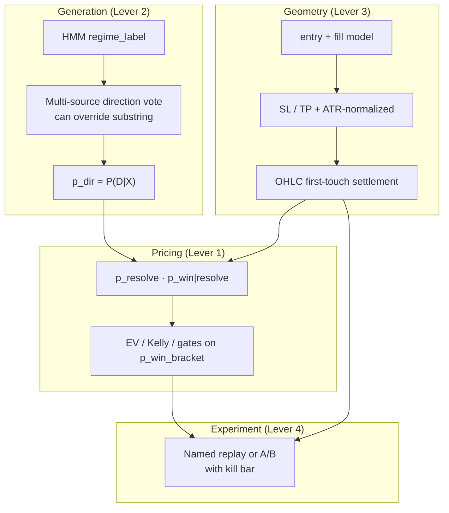

# Calibration + Reachability — Definitive Fix Methodology

> **Priority:** P0 methodology · **Status:** methodology locked; **L1 fail-closed unscored policy SHIPPED** (bracket gate before publish, `suppress_reason=bracket_unscored`) · **Date:** 2026-09-24 · **Version:** platform **v8.0.0** (`docs/Setup/CHANGELOG.md`)  
> **Type:** definitive approach for the two product bars (calibration · reachability)  
> **Parent evidence:** `docs/QUANT_AUDIT_SIGNAL_CALIBRATION_REACHABILITY_PNL.md` · `20260915_TWO_WEEK_RETROSPECTIVE_SIGNAL_QUALITY_REVIEW.md` · `20260922_QUALITY_MEASUREMENT_LAYERS_ASSESSMENT.md` · `20260922_L1_CONFIDENT_CALIBRATION_RECOMMENDATIONS.md`  
> **Supersedes for execution priority:** R0–R8 as a *standalone* program, calendar-gated shadow accumulation (“wait 2 weeks of logs”), and Kairos v3 as a prerequisite for either bar  
> **Does not wait for:** Oct 5 Stage 1 · more organic shadow volume · L1 dashboard polish  
> **Build order is named below; this file is the methodology, not the PR**

---

## 0. Why this worklog exists

Since 2026-08-25 the stack shipped a large measurement substrate (episode bias, settlement contract, vol-tier keys, side views, `p_win_bracket` shadow, geometry stamps, L1 board) and almost no change to the two things the product is judged on:

| Bar | Definition | 2026-08-25 | 2026-09-24 | Moved? |
|---|---|---|---|---|
| **Calibration** | Accurate signal generation: regime **label**, **direction**, **strength** | Unstable labels; substring direction; `p_win` bias +0.27 | Stable labels (unmeasured for correctness); same substring rule; bias **+0.34**, gold/FX +0.36…+0.46 | **No / worse** |
| **Reachability** | Accurate P/L from **entry, SL, TP** + honest **W/L** | Close-only; brick-count PnL; multi-truth expired | Same settlement physics; exit≠fill; costs=0; 3 expired meanings | **No** |

What *did* move (and must not be lost): expiry 60.6% → 21.1%, deadline-aware selection live, shadow-leak P0 fixes, gated `p_regime` Brier 14/14, debounced labels.

**Diagnosis of the miss:** recommended work was mostly *measurement and flip-gating* around an unchanged core:

```text
direction = substring(regime_label)          # generation unchanged
EV        = p_dir · TP − (1−p_dir) · SL      # category error live
outcome   = close-walk, TP-first, 48h        # reachability physics unchanged
PnL       = designed brick counts            # not fill-accurate
```

Shadow mode here is a **comparison log**, not an experiment that can fail a model. When evidence was negative (trend-HMM Markov worse on gold; early `bracket_accept` n=8 0% win expectancy −1.00; B5 veto 100%), the response was more instrumentation — not a change to generation, settlement, or PnL.

This worklog defines **four levers** that can actually disprove or improve the twin bars. Anything that does not map to a lever is out of scope.

---

## 1. Target end-state (what “fixed” means)

### 1.1 Calibration — accurate signal generation

Three *separate* claims, each with its own target variable, metric, and fail bar. Never blend them into one bias number.

| Claim | Target random variable | Live estimator after fix | Primary metric | Fail bar (kill / shrink) |
|---|---|---|---|---|
| **Label** | True regime cell over a run (vol tier × direction), vs debounced HMM label | Same label source, but **scored for correctness**, not only flip-rate | Label hit-rate / confusion vs realized cell (geometry-free forward returns + ATR-anchored vol) | Hit-rate ≤ base-rate majority class, or run-length distribution unstable across 7d windows |
| **Direction** | \(D = 1[\text{favorable move within horizon}]\) | **Multi-source direction** (not substring-only); side can be voted or vetoed | Direction hit-rate excess over 0.5, per (symbol, side); Brier on `p_dir` | Excess ≤ 0 on hold-out symbols/windows; or vote never disagrees with HMM (decorrelation failed) |
| **Strength** | \(P(D \mid X)\) then \(P(R \mid geometry)\) | `p_dir` (honest direction prob) × geometry → `p_win_bracket` | Reliability: per-cell bias_raw \|≤ 0.05 at n_ep≥10; Brier skill > 0 | Cell remains OVERCONFIDENT after shrink; or discrimination (AUC / slope) ≈ 0 |

**Non-negotiable:** EV/gates/Kelly may only price the **same event** the resolver labels win. Until `p_win_bracket` is live, product language is `p_dir`, not “win probability.”

### 1.2 Reachability — accurate entry / SL / TP / P/L / W/L

| Object | Today | Target |
|---|---|---|
| Entry | last 1h close, no fill model | explicit fill model: mid/close + spread/slip bps (even if coarse) |
| SL / TP | `entry ∓ brick_size × bricks` | same construction allowed, but **distances recorded as ATR-normalized and absolute** at capture; optional geometry from live reachability pick once proven |
| Outcome | close-only first-passage, **TP-first** | **OHLC first-touch** when highs/lows exist; same-bar = **SL-first** (conservative, matches heavy OCO); gaps through SL → SL at gap open |
| Exit price | triggering **close** (or last close) | **touch price** under OHLC; for close-mode retain close but **PnL must use exit − entry** |
| PnL | `tp: +tp_bricks`, `sl: −sl_bricks`, expired MTM optional | `pnl = sign · (exit − entry) − costs` in price units; brick counts are geometry labels only |
| W/L | `tp_hit` / `sl_hit` only for calibration | same outcomes, but **all three** outcomes enter measurement: win, loss, expired-with-MTM; survival model owns `p_resolve` |
| Expired | 3 economic meanings | one taxonomy: `expired_mtm` (resolver) · `stale_unclosed` (retention) · `paper_flat` (book) — never share a bare `expired` in analytics |

**Non-negotiable:** selection physics (heavy grid) and live settlement physics must call the **same** `settlement_contract` rules (bar type, same-bar policy, costs). Divergence is a regression, not a config.



---

## 2. Guiding rules (strengthened from 2026-09-16)

| Rule | Meaning |
|---|---|
| **Same event** | Every probability in EV is P(resolver win), or is explicitly dual-target (`p_dir` and `p_resolve`) and never sold as one number. |
| **One settlement** | `settlement_contract.py` is the only outcome+PnL authority for resolver, heavy grid, paper, scorecard. |
| **Shadow ≠ calendar** | `shadow → live` requires a **named experiment** with a **pre-registered pass bar and kill bar**. Days of logs do not flip modes. |
| **Measurement first, honesty second, comfort never** | Prefer a model that is visibly wrong over an enforced p_win that looks fine. Raw bias is the scoreboard. |
| **Disprove is a success** | A model that fails its kill bar is closed, deleted, or demoted — not “kept in shadow pending more data.” |
| **No measurement-only roadmap items** | New flags/migrations must attach to a lever experiment. Dashboards are not progress on the twin bars. |
| **Severity batches** | critical → high → m…; each batch full pytest + smoke before the next. |

---

## 3. Lever 1 — Kill the category error in production

**Problem.** `p_win` estimates something like \(P(D)\) (direction). EV prices it as \(P(R)\) (TP before SL in 48h). That is the calibration lie at the center of L1.

**Current state (do not rebuild).**

- Formula exists: `p_win_bracket = p_resolve × p_win|resolve` (`p_win_bracket.py`).
- Wiring exists in shadow: lookup before EV, `apply_bracket_to_ev()`, Kelly `ev_scale` (`orchestrator.py` ~3305–3583).
- Modes: `p_win_bracket_mode: shadow`, `p_win_in_ev_mode: shadow`, `min_p_win_bracket: 0.20`.
- Early live evidence **against** naive flip: `bracket_accept` n=8, 0% win, expectancy_r −1.00 (2026-09-24 pulse). Live `p_win_bracket` p50 ≈ 0.076, max ≈ 0.31 — gate thr must stay on **bracket scale** (0.20), never 0.45.

### 3.1 Target probability model

```text
p_dir        = logit-pool of directional sources          # rename of today's p_win_raw
p_resolve    = P(TP or SL by 48h | symbol, vol_tier, bucket, side)
p_win|resolve= Beta-Binomial shrink of tp/(tp+sl) in cell
p_expire     = 1 − p_resolve

p_win_bracket = p_resolve · p_win|resolve
EV = p_win_bracket · (net_TP) − (1 − p_win_bracket − p_expire) · (net_SL) − costs
     + p_expire · E[MTM | expire]                          # when expired MTM is real PnL
Kelly on p_win_bracket (or on the 3-outcome EV scale), never on p_dir alone
```

**Fail-open policy (must be explicit):** if `n_stored` below floor for a cell → **do not invent p_win_bracket**. Either (a) skip qualification (fail-closed, preferred for live book) or (b) fail-open with `bracket_unscored=true` and **zero Kelly multiplier / no EV credit**. Silent “use p_dir as p_win” is forbidden.

### 3.2 Methodology

| Step | Work | Acceptance (can fail) |
|---|---|---|
| **L1.a** | Freeze event definition in one docstring + schema comment: what `win` means under settlement contract | Review sign-off; no code path uses a different win |
| **L1.b** | Reliability harness: per-cell (symbol, side, vol_tier, bucket) reliability table for **both** `p_dir` and `p_win_bracket` on resolved+expired MTM book | Script prints slope/intercept/Brier; fixture + live pull |
| **L1.c** | **Pre-register experiment E1** (see §6): bracket-priced EV vs dir-priced EV on same historical anchors **and** forward paper book | Table with pass/kill bars filled *before* looking at results |
| **L1.d** | Decision: flip `p_win_in_ev_mode: live` only if E1 passes; then `p_win_bracket_mode: live` for gates | Either flip or **kill/retune** the bracket model — not “hold shadow” |
| **L1.e** | Product language: Discord/UI/docs use `p_dir` until L1.d; after flip use `p_win` only for bracket | Grep clean; no marketing claims on p_dir |

### 3.3 Kill bars for Lever 1 (pre-registered)

Flip **fails** (keep dir EV or redesign bracket) if **any**:

1. Forward qualified book `expectancy_r` (net of costs, 3-outcome) **worse** than dir baseline by > 0.05R at similar n.
2. Qualified n drops below **50%** of baseline for ≥ 7d without a corresponding jump in expectancy.
3. `|bias_raw|` on the qualified book does **not** fall by ≥ 0.05 absolute vs baseline window.
4. `bracket_accept` cohort remains all-loss at n ≥ 30 (hard kill: model is inversely wrong — invert or scrap `p_win|resolve`).

**If kill fires:** do not raise `min_p_win_bracket` and wait. Replace `p_win|resolve` estimator (see L1 alternatives below), or set `p_win_bracket_mode: off` and mark the model disproved.

**L1 alternatives if E1 kills the current estimator** (in order):

1. Empirical touch model: `P(touch TP in 48h)` / `P(touch SL in 48h)` from OHLC first-touch counts per (symbol, vol_tier, bucket, side) with Beta shrink — not `tp/(tp+sl)` survivorship.
2. Scale `p_dir` by empirical `p_resolve` only (weaker, but cheaper): `p_win_bracket ≈ p_dir · p_resolve · f(bucket)` with `f` fit on closed win rates.
3. Heavy-grid parity estimator from Renko journal first-touch (closer to selection physics).

### 3.4 Files (expected)

`p_win_bracket.py`, `ev_engine.py`, `orchestrator.py` (R2 block), `calibration_enforcement.py`, `feature_flags.yaml`, `scripts/replay_p_win_bracket_gate.py` (extend to 3-outcome + costs), `tests/test_p_win_bracket.py`, migration for reliability view if missing.

---

## 4. Lever 2 — Replace the direction rule

**Problem.** Generation of the *side* is a string match:

```python
# orchestrator.py ~621–647, ~3223
direction = "short" if "bear" in regime_label.lower() else "long"
signal    = "buy" if "bull" in label else "sell" if "bear" in label else "neutral"
```

No shadow path can *disagree* with the HMM label. Strength sources only modulate confidence after the side is fixed. Label stability ≠ label correctness; neither is direction accuracy.

### 4.1 Target generation stack

```text
Inputs:  HMM label + trend_probs (gated), TimesFM z-map, Markov 3-state (if ever flipped),
         optional macro/trend labels (capture-only until they earn a vote)

p_dir    = calibrated multi-source direction probability
side     = argmax(p_dir_long, p_dir_short) if max ≥ dir_min
           else NEUTRAL (no trade — this is new and required)

Veto / soft: regime_conf, context_alignment, regime age (Kairos later — not required)
```

**Critical design choice:** `side` must be allowed to be **neutral even when the label is bull/bear**, and a second source must be able to **flip** the side (or veto) on a scored basis. If the second source never changes the decision, it is decoration.

### 4.2 Direction candidate set (build as offline experiments first)

| ID | Candidate | Role | Why |
|---|---|---|---|
| **D-HMM** | current substring (debounced label) | baseline | must beat this |
| **D-TFM** | TimesFM z-map sign / P(up) with short invert | alternate | already in blend; re-use as **side** not just strength |
| **D-MK3** | 3-state trend HMM step-ahead | alternate | **known weak on gold** — only as vote with symbol gates |
| **D-CON** | consensus: ≥2 of {HMM, TFM, MK3} | aggregation | reduces single-label lag (AAPL high_vol_strong_bull case) |
| **D-AGE** | HMM side only if regime age < T* else flip/neutral | timing | first Kairos-style knob that can touch direction without geometry |

### 4.3 Methodology

| Step | Work | Acceptance |
|---|---|---|
| **L2.a** | **Label scorecard** (missing today): for each symbol, compare debounced `regime_label` run to realized geometry-free outcomes (signed move / ATR at h ∈ {4,12,24,48}); report hit-rate, confusion, run-length | Script + table; this is the first honest label metric |
| **L2.b** | Offline **direction tournament**: for each candidate and each symbol/side, score hit-rate excess, Brier on p_dir, episode-clustered | Rank per symbol; no global “one model” claim |
| **L2.c** | **Pre-register experiment E2** (§6): `D-CON` (or best) vs `D-HMM` on forward shadow that **logs would-flip / would-veto** and stamps `direction_alt` on `nt_signal_sim` | Shadow for min 10 episodes/symbol **or** 14d; named bars |
| **L2.d** | Flip `direction_source_mode: live` only if E2 passes | Or kill candidate set and keep D-HMM with documented ceiling |

### 4.4 Kill bars for Lever 2

1. No candidate beats `D-HMM` on **majority of symbols** with n_ep ≥ 10 (excess hit-rate + Brier skill).
2. Best candidate’s disagreements with HMM are not informative (disagreement set win-rate ≈ coin).
3. Consensus never changes side (decorrelation failed) → treat as no-op, kill.

**Strength after L2:** `p_dir` is calibrated per cell (L1.b reliability). `regime_conf` remains a gate but is **not** claimed as probability. Product “strength” = `p_dir` + `p_win_bracket` + episode n — not a single 0–1 score.

### 4.5 Files (expected)

`regime_engine.py` (label scoring helpers), new `regime_platform/sweep_orchestrator/direction_model.py` (pure), `orchestrator.py` `_compute_trade_signal` + EV direction sites (~2983, ~3223), `feature_flags.yaml` `direction_source_mode: off|shadow|live`, migration `nt_signal_sim.direction_alt` / `direction_source`, tests.

---

## 5. Lever 3 — Fix settlement physics (reachability → P/L + W/L)

**Problem.** Even perfect probabilities cannot produce accurate P/L and W/L if settlement is close-only, TP-first, brick-count PnL, free, and three different “expired”s.

### 5.1 Canonical settlement spec (the contract)

```text
Inputs: entry, side, sl, tp, bars (prefer OHLC), deadline_bars=48, same_bar_policy, costs

Path rule:
  if high/low available:
    first bar where low ≤ SL or high ≥ TP (buy mirrored for sell):
      both touched in bar → same_bar_policy (default SL_FIRST going forward)
      gap open through SL → exit = open (or SL if open beyond? use open — worse than SL)
      exit_price = SL | TP | open (gap)   # true touch/fill proxy
  else:
    close-walk as today but same_bar_policy applied
    exit_price = triggering close

Outcome: tp_hit | sl_hit | expired_mtm
PnL:     (exit_price − entry) * side_sign − costs(entry)
         # NEVER +tp_bricks / −sl_bricks as the money number
Brick counts: stored as geometry metadata only

Expired:
  expired_mtm     — full deadline reached; exit=last close; real PnL
  stale_unclosed  — retention kill; PnL NULL; excluded from money; flagged
  paper_flat      — book risk policy; $0; excluded from model calibration
```

### 5.2 Reachability → ex-ante (the actual “reachability fix”)

Ex-post tables (`nt_bracket_reachability`) must feed **ex-ante** decision inputs:

```text
For a candidate trade (symbol, side, vol_tier, bucket = |TP−entry|/ATR):
  p_resolve, p_win|resolve, E[MTM|expire], E[bars_to_resolve]
  from stored rows with Bayesian shrink + min n_stored

Then geometry choice (heavy pick / light risk) optimizes expected net R
under the same settlement contract — not grid Sharpe alone.
```

| Step | Work | Acceptance |
|---|---|---|
| **L3.a** | Enable OHLC in price fetch path; `normalize_bars` already supports it (`settlement_contract.py`) | Fixture tests: gap, same-bar, touch-then-reverse (close-walk would expire; OHLC hits) |
| **L3.b** | Default `settlement_same_bar_policy: sl_first` via **replay** (not silent config flip) | E3 (§6): SL-first vs TP-first on anchors; if PnL drop is “optimism removal,” accept |
| **L3.c** | PnL from `exit − entry` in resolver + paper + scorecard; dual-report `pnl_bricks_meta` | Unit tests; parity script on historical rows |
| **L3.d** | Cost model: fill `SettlementCosts` per symbol class (spread/slip/commission bps); never default 0 on expectancy dashboards | Table of assumed costs; sensitivity ±50% |
| **L3.e** | Expired taxonomy columns + views (`expired_kind`); fix paper age-expire vs sim MTM disagreement | One SQL definition of W/L/expired per audience |
| **L3.f** | Heavy grid calls settlement contract with **same** bar policy and costs | Parity test: grid score vs live score on shared anchors differ only by data window |

### 5.3 Kill bars for Lever 3

1. OHLC path shows **no** material difference vs close-walk on touch rates (then OHLC is optional — document and keep close).
2. Fill-PnL vs brick-PnL divergence is huge and unstable → fill model is wrong; stop and recalibrate costs/exit, do not publish either.
3. Heavy vs live parity still fails after L3.f → do not use heavy Sharpe for live geometry.

### 5.4 Files (expected)

`settlement_contract.py`, `eod_resolver.py`, `paper_book.py`, scorecard migrations, `heavy_sweep.py` scoring hooks, `price_fetcher` / candle fetch (OHLC), `feature_flags.yaml` (`settlement_bar_mode: close|ohlc`, `settlement_same_bar_policy`), tests + `scripts/replay_settlement_parity.py`.

---

## 6. Lever 4 — Experiment protocol (disprove or improve)

Measurement without a kill bar is the failure mode of the last three weeks. Every lever ships through this protocol.

### 6.1 Experiment card (required before any `shadow → live`)

```text
E-id:            E1 | E2 | E3 | ...
Hypothesis:      one sentence (what becomes true if we flip)
Treatment:       exact flag / code path under test
Control:         exact baseline
Unit:            episode (not tick) · book: qualified live book
Window:          fixed dates or min n_ep (pre-declared)
Pass bar:        numeric (e.g. expectancy_r ≥ baseline + 0.05 or flat with |bias|↓≥0.05)
Kill bar:        numeric (any fail → model disproved / retune, no “extend shadow”)
Decision owner:  single person/role (no dual shrink)
```

### 6.2 Pre-registered experiments for this program

| ID | Hypothesis | Pass | Kill |
|---|---|---|---|
| **E1** | Pricing EV/Kelly on `p_win_bracket` improves honest expectancy vs `p_dir` | 3-outcome expectancy_r ↑ or flat **and** \|bias_raw\| ↓ ≥ 0.05 **and** n ≥ 50% baseline | expectancy ↓ > 0.05R · n collapse · \|bias\| unchanged · accept-arm all-loss at n≥30 |
| **E2** | Multi-source direction beats substring label | majority symbols excess hit-rate > 0 and Brier skill > 0 at n_ep≥10 | no symbol-level win · disagreements uninformative · never flips side |
| **E3** | SL-first + OHLC + fill-PnL is the honest baseline | touch/expiry mix matches intuition; W/L stable under re-scoring; no catastrophic PnL lie | PnL wildly different with no economic story → fix model before publishing |
| **E4** | Live reachability pick (geometry) improves book vs Sharpe pick | within-symbol vetoed/kept R with n≥20/arm; expiry↓ on “nothing survived” symbols | no within-symbol edge (symbol-confounded only) → keep diagnostic |

### 6.3 Shadow-mode hygiene (Lever 4 rules)

1. **Every** `*_mode: shadow` in `feature_flags.yaml` must reference an E-id or be **deleted**.
2. `dynamic_min_rr_mode`, `timesfm_k_adaptive_mode`, `signal_stream_meta_model_mode` (no consumer), `context_alignment_gate_mode` without flip path: **close or bind to E-id** within this program.
3. Contaminated windows (2026-09-13→14 shadow leak) are **quarantine** from all go/no-go tables.
4. Gate flips only via **named replay script** outputs committed to the worklog — not log sentiment.
5. If an experiment is inconclusive at max window (e.g. 28d or n_ep=50), **default is kill**, not eternal shadow.

### 6.4 What is explicitly *not* progress

- New migrations that only add columns/views
- L1 board styling / rename work (allowed as hygiene, not as bar progress)
- Kairos v3 edge matrices (valuable later; **geometry-free by design**; does not fix PnL/W-L)
- Further gate tightening (kelly/regime/p_win floors) without E1/E2
- “More shadow data” without a decision date

---

## 7. Sequencing (critical path)

```text
Week 0 (immediate, no calendar wait)
  ├─ L1.a event freeze + L1.b reliability harness (honest scoreboard)
  ├─ L2.a label scorecard (first label correctness metric)
  ├─ L3.a OHLC fixture tests + L3.e expired taxonomy
  └─ Bind or delete orphan shadows (Lever 4 hygiene)

Week 1–2
  ├─ E1 offline replay (3-outcome + costs) → flip or kill bracket pricing
  ├─ L3.b/c/d settlement physics replay → SL-first + fill PnL
  └─ E2 offline direction tournament

Week 2–4 (forward)
  ├─ E1 forward paper book arm
  ├─ E2 shadow direction_alt stamp
  └─ E3 closeout of settlement defaults

Then (only after E1)
  └─ E4 geometry / reachability pick live (Oct 5 work becomes optional)
```

**Dependency note:** L3 (PnL truth) should land **with or before** E1 flips, because E1’s pass bar is expectancy_r — that metric is worthless while PnL is brick-count theater. Minimum: L3.c fill-PnL dual-report so both arms are scored the same.

Kairos / regime-age knobs may proceed in parallel **only** as measurement; they must not gate E1–E3.

---

## 8. Definition of done

### 8.1 Calibration done

- [ ] Label hit-rate published per symbol (not only flip-rate)
- [ ] Direction can disagree with HMM; tournament results committed; winner flipped or ceiling documented
- [ ] `p_dir` named and calibrated; EV uses `p_win_bracket` **or** bracket model formally killed
- [ ] Qualified-book reliability: \|bias_raw\| ≤ 0.05 at n_ep ≥ 10 on ≥ ⅔ of active symbols **or** those cells quarantined
- [ ] No product copy claims win probability from directional confidence

### 8.2 Reachability done

- [ ] One settlement module; heavy grid parity tests green
- [ ] OHLC first-touch (or documented close-walk exception)
- [ ] PnL = exit − entry − costs everywhere money is shown; brick counts are metadata
- [ ] Expired taxonomy single-sourced; W/L/expiry per audience defined
- [ ] Ex-ante `p_resolve` / `p_win|resolve` actually used in EV (not only stored)

### 8.3 Program done

- [ ] Every live/shadow flag maps to E-id or is deleted
- [ ] Each E-id has pass/kill outcome recorded (pass → live, kill → closed)
- [ ] No mode sits in shadow without a dated decision

---

## 9. Out of scope (this methodology)

| Item | Why |
|---|---|
| EV weight re-tuning (0.25/0.20/0.25) | Secondary to event definition; do after E1 |
| Masaniello / Kelly form | Sizing form is fine once input probability is honest |
| User marketing / app chrome | L1 language fix only |
| Multi-symbol portfolio optimisation | Downstream of honest per-trade PnL |
| Full OptionsGreeks-style barrier math | Empirical touch + shrink is enough for v1 |
| Forcing Oct 5 geometry flip | E4 has its own bars; earlier is allowed if E1+L3 done |

---

## 10. Operator decisions (locked 2026-09-24)

Grounded in live evidence (bracket pass-rate ~21% @ 0.20; thin `n_stored`; C6 self-starving; trend-HMM gold failure; B5 symbol-confound; three weeks of calendar-shadow with no flip).

| # | Decision | Rationale (tested / observed) |
|---|---|---|
| **1** | **Dual-stream fail policy.** Live QUALIFIED book (Discord / paper): **fail-closed** — unscored `p_win_bracket` ⇒ no size (research capture keeps the row). Research stream (`nt_signal_sim` all): **fail-open** + `bracket_unscored=true`, never feeds EV/Kelly as if scored. | Live already prices a category error; fail-open would preserve volume and keep L1 dishonest. Research must keep capturing or C6 starves `n_stored`. Mirrors existing qualified vs research split (L1/L2). Bracket pass-rate ~21% → expect a real volume drop; that is the point. |
| **2** | **Same-bar default `sl_first` going forward**; replay E3 quantifies the optimism removal. Keep `tp_first` only for historical lineage re-scores. | Live policy is documented as optimistic; heavy OCO is already SL-first (selection ≠ settlement bug). Same-bar both-hit is rare but systematically flatters W/L. |
| **3** | **Direction authority:** shadow **may flip** side; live ships **veto-to-neutral only** until E2 proves flip on majority symbols. | Trend-HMM Markov was *worse* on gold (17.5% vs 57.2%) — unproven flip is dangerous. Consensus that never changes the decision is a no-op; flip is allowed in shadow so E2 can measure it. |
| **4** | **Max experiment window: 28d or n_ep=50, whichever first; default action is kill** (not extend shadow). | L1 needs n_ep≥10/cell; 50 ≈ five cells. Calendar-wait already failed for three weeks (R2 hold, B5 overdue). Inconclusive ⇒ kill. |
| **5** | **Orphan shadows: bind to E-id or delete in the hygiene PR** (same release train as this methodology). Kill list: `dynamic_min_rr_mode` (superseded 2026-09-20), `timesfm_k_adaptive_mode` (no evidence), `signal_stream_meta_model_mode` (no consumer), `context_alignment_gate_mode` (no flip path) unless bound to E2/E4. | Flags without E-ids are how measurement became theater. One PR keeps the tree honest. |

---

## 11. Appendix — one-page operator summary

| Lever | Changes what | Proves/disproves | First artifact |
|---|---|---|---|
| **1 Category error** | EV/gates/Kelly event | Does bracket pricing earn money? | E1 replay table |
| **2 Direction rule** | Side generation | Can anything beat substring HMM? | Label scorecard + tournament |
| **3 Settlement physics** | Entry/SL/TP/PnL/W-L | Is money number real? | Fill-PnL + OHLC parity |
| **4 Experiment protocol** | Process | Did we learn or just log? | Orphan flag kill list |

**The twin bars move only when (1) the priced event equals the settled event, (2) the side can be wrong and corrected, (3) PnL equals exit − entry − costs, (4) every experiment can fail.**

Until then, shadow mode is theater with good SQL.
