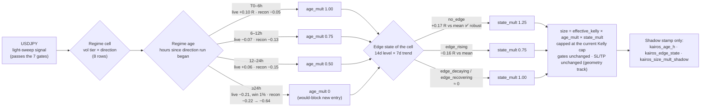

# 2026-09-24 — Edge-state matrix: regime age (T0→T48h), USDJPY matrix, `/backtest/run` status

**Type:** research worklog (read-only analysis; no live code, config, or schema change).
**Scope doc:** `docs/scopes/20260923_KAIROS_EDGE_STATE_SCOPE.md` (name/rescope pending).
**Script (deleted 2026-09-24):** `scripts/regime_age_decay_test.py` was R-based (geometry-dependent) and is withdrawn with §2–§3; superseded by `scripts/kairos_discovery.py` (Kairos v3 P1).

---

## 1. Is `/backtest/run` the half-built walk-forward test?

**No. It's a separate, older, generic backtester, and it doesn't replay the production pipeline.**
The walk-forward work in this thread uses `scripts/reconstruct_signal_history.py`, not this endpoint.

| | `/backtest/run` (`routers/backtest.py:85` → `core/backtester.py`) | `scripts/reconstruct_signal_history.py` |
|---|---|---|
| Signal rule | Regime-only toy rule: low-vol + bull → long, high-vol + bear → short, else flat (`_generate_signal`, `backtester.py:432`) | Production direction: HMM trend on 1h bars, one signal per bar, like the light sweep |
| HMM | `RegimeHMM` refit every 50 bars (`refit_every`) on a 200-bar window | Production `RegimeHMM` cold-fit on every bar (matches live 83% on direction) |
| Geometry | Optional `stop_loss_pct` / `take_profit_pct` (percent of price, off by default) | Renko brick = k × ATR, SL/TP in bricks (live values) |
| Settlement | Close-to-close mark-to-market, exit on signal flip | `settlement_contract.settle` with a 48-bar expiry, OHLC touch (matches live outcomes 96% on EURUSD) |
| EV / p_win / TimesFM / 7 gates | None | None (they can't be rebuilt from history) |
| Output | 30+ portfolio metrics, persisted to `ta_backtest_result` | Per-signal R for edge-state / regime tests |

The "half-built" parts inside `/backtest/run`:
- **Per-trade SL/TP never reach the API.** `BacktestConfig.stop_loss_pct` / `take_profit_pct` exist ("Phase 3 — Execution Realism") but aren't fields on `BacktestRequest`, so the endpoint always runs with them disabled.
- **`RiskManager()` is instantiated but never used** (`backtester.py:197`).
- **The end-of-data close skips commission/slippage** (`backtester.py:412-424`).
- **Return series are hourly but called `daily_returns`**, and annualisation assumes daily bars.

**Recommendation:** leave it alone for this work. Its signal logic isn't the platform's, so its
metrics can't validate or tune the sweep. If a portfolio-metrics view of the reconstruction is
wanted later, feed reconstructed signals into `_compute_metrics` rather than extending its strategy.

---

> **Correction (2026-09-24, user):** §2–§3 measure edge with R, win/SL/expired rates and the
> tight-SL argument. All of these depend on the current SL/TP geometry, which is still unresolved,
> so they are **not evidence for or against the thesis**. That mixes two tasks: finding edge and
> decay (the thesis) versus tuning parameters. The `age_mult` / `state_mult` values and the "don't
> tighten SL" conclusion are withdrawn. Thesis v3 (geometry-free, dual timeline):
> `docs/scopes/20260924_KAIROS_V3_SCOPE.md`.

## 2. Regime age: does edge decay from T0 to T+48h? (geometry-dependent; see correction above)

**User thesis:** the longer a symbol stays in a regime, the higher the risk and the lower the
returns (W/L, P/L), so knobs should tighten with age.

**Definition.** Regime age = hours since the symbol's current run began. Two run definitions,
fixed in advance:
- `cell`: vol tier × direction;
- `dir`: direction only.

**Test design.** R is demeaned within symbol × vol tier, so a vol tier that both lasts longer and
earns less can't pose as an age effect. The bootstrap is clustered on symbol-days. Tests are
one-sided (decay = negative) with Holm correction over 4 tests per dataset.

### Results

| Dataset | Run | R per doubling of age | R(≥24h) − R(<6h) | Holm |
|---|---|---|---|---|
| Live 30 d, 14 symbols (raw labels) | dir | **−0.022** [−0.044, +0.001] | −0.113 [−0.240, +0.019] | 0.25 / 0.29 |
| Live 30 d | cell | −0.013 [−0.038, +0.014] | −0.097 [−0.240, +0.061] | 0.38 |
| TDVA 21 mo, 5 symbols | dir | −0.009 [−0.025, +0.008] | −0.069 [−0.248, +0.126] | 1.0 |
| TDVA 21 mo | cell | (98% of cell runs are < 6h; untestable) | — | — |

Live, direction runs, all 14 symbols. R_x is R demeaned within symbol × vol tier:

| Age | n | R_x | Win (TP) | SL | Expired | Median MAE (R) | p_win_dir − win |
|---|---|---|---|---|---|---|---|
| 0–6h | 6,784 | **+0.038** | 18.6% | 37.8% | 43.6% | 0.54 | 0.33 |
| 6–12h | 1,160 | −0.032 | 15.5% | 39.6% | 44.9% | 0.53 | 0.51 |
| 12–24h | 1,026 | −0.082 | 11.2% | 36.9% | 51.9% | 0.43 | 0.55 |
| 24–48h | 1,239 | **−0.099** | 7.6% | 32.9% | **59.5%** | 0.56 | 0.45 |
| ≥48h | 580 | −0.022 | 12.8% | 39.0% | 48.3% | 0.69 | 0.52 |

### What this says about the thesis

1. **"Lower returns with age": leans yes live, but isn't proven.** The decline runs monotonically
   from 0–6h to 24–48h (+0.04 → −0.10 R), but no test passes after correction. TDVA doesn't
   replicate it pooled.
   - The exception is **USDJPY**, which shows it in *both* datasets: its reconstruction slope is
     −0.037 per doubling (CI excludes 0), and its live 0–6h +0.10 R falls to 24–48h −0.21 R (see §3).
2. **"Higher risk with age": not supported.** The SL-hit rate doesn't rise with age (37.8% →
   32.9%), and median MAE is flat. What rises is the **expiry** share (44% → 60%). Old regimes
   don't hurt the trade; the price **stalls** and the TP is never reached.
3. **So "tighten SL with age" is contraindicated.** The SL isn't what fails in old regimes; a
   tighter SL just converts stalls into losses. That matches the EURUSD result (halving SL cost
   0.20 R). The time-consistent knobs are **size** and **whether to enter at all**, plus holding
   time. (SL/TP stays on the separate geometry track either way.)
4. **Calibration (#7).** p_win doesn't know regime age. Its overconfidence (p_win_dir − win) grows
   from 0.33 at 0–6h to about 0.5 after 6h.
   - Caveats: `p_win_dir` is on only 7.6% of rows, and "win" here means TP hit only, so the
     *level* of the gap is overstated. The *change with age* is the signal.
   - **Regime age is the strongest candidate so far for a calibration bucket dimension.**

### Method caveats

- **Reconstructed labels flap more than live ones.** They come from a cold fit on every bar, which
  compresses regime ages (USDJPY direction runs: 26% survive 6h, 4% survive 24h, 0.6% survive
  48h). The reconstruction therefore under-samples old regimes.
- **The live data is all raw, pre-debounce labels.** The 2026-09-22 debounce should lengthen runs.
- **The right source for "age" going forward is the live debounced label stream**, measured from
  the first debounced tick of the run.

---

## 3. Matrix for one symbol: USDJPY (candidate knobs, shadow only)

USDJPY is the one symbol with effects that replicate: `no_edge` beats its average by +0.17 R,
robust to geometry and positive in all four time blocks; the age decay shows in both datasets.
Current geometry (`config/brick_params.yaml`): brick 0.10, SL 3, TP 6 (not tuned here).



**USDJPY regime cells** (TDVA 21 months, OHLC settlement; symbol mean R −0.096; live 30-day R is
thin at 19–244 episodes per cell):

| Regime cell | Recon n | Recon R | Recon win | Live n | Live R | Latest edge state (recon) |
|---|---|---|---|---|---|---|
| high_vol / bear | 856 | −0.129 | 21.0% | 52 | +0.090 | edge_decaying |
| high_vol / bull | 969 | +0.032 | 30.2% | 92 | −0.068 | edge_decaying |
| med_high_vol / bear | 1,169 | **−0.212** | 17.9% | 97 | **−0.306** | no_edge |
| med_high_vol / bull | 1,259 | −0.017 | 31.2% | 244 | +0.047 | edge_rising |
| med_low_vol / bear | 1,135 | −0.140 | 21.2% | 99 | +0.071 | no_edge |
| med_low_vol / bull | 1,413 | −0.130 | 27.8% | 137 | +0.236 | edge_rising |
| low_vol / bear | 774 | +0.007 | 29.7% | 26 | −0.141 | edge_recovering |
| low_vol / bull | 843 | −0.142 | 25.1% | 19 | +0.105 | edge_recovering |

**Prescribed knobs** (candidates for a shadow stamp; *none* is validated for live):

| Knob | Parameter | Values | Evidence | Status |
|---|---|---|---|---|
| Age size multiplier | `age_mult` by direction-run age | 0–6h 1.00 · 6–12h 0.75 · 12–24h 0.50 · ≥24h 0 | USDJPY decays in both datasets (recon slope CI < 0); the pooled live trend is n.s. | Shadow candidate |
| Edge-state size tilt | `state_mult` | no_edge 1.25 · edge_rising 0.75 · others 1.00 | USDJPY no_edge +0.17 R, Holm-significant, robust in 3/4 geometries, positive in 4/4 time blocks | Shadow candidate (strongest) |
| Gate thresholds | min_p_win / min_regime_conf / min_kelly / min_ev | Unchanged (0.55 / 0.60 / 0.02 / 0) | No gate separates winners pooled; no per-state threshold passes Holm | No change |
| Calibration dimension | p_win bias bucket += age band | 0–6h / 6–24h / ≥24h | p_win overconfidence grows with age | Offline test first (§4) |
| SL/TP | — | Current brick params | Out of scope (geometry track); the data argues *against* tightening SL with age | No change |

Excluded from the parameters: the 48-bar expiry. It's a time knob, but shortening it only
realises stalled trades earlier at MTM. Test it with the fractional-ATR simulation once the
geometry track settles.

---

## 4. Thesis workshop (v2)

**Refined thesis:**
> For each symbol, inside each regime, **how does our signal's edge evolve from the moment the
> regime starts (T0) through T+48h**, and which knobs should scale with that clock?

Why the reframe fits the evidence:
- **The edge state as a 14-day rolling measure is a lagging monitor.** It isn't predictive except
  for USDJPY.
- **Most symbol-level edge-state changes are regime shifts** (78% of changes, 83% of diagonal
  jumps). The regime transition is where the forecastable content sits.
- **Regime age is a clock we already have.** It needs no model, and live data already shows a
  decline plus a growing calibration gap along it.

**Proposed model shape**, replacing "4 edge states × knobs":

```
row    = regime cell (vol tier × direction), 8 per symbol
column = regime age band (0–6h, 6–12h, 12–24h, 24–48h, ≥48h)
cell   = n, R, win/SL/expired, p_win bias, P(regime survives +48h)
modifier = edge state (monitoring + a per-symbol tilt only where proven, e.g. USDJPY)
knob   = size multiplier and calibration shift per (age band); gates unchanged
```

Underlying factors ("time, order-book volume, momentum, other TA"), in the order to test, one at a time:

| Factor | Available? | First test |
|---|---|---|
| Time in regime (age) | ✅ from labels | Done above: live trend, USDJPY replicates |
| Session / hour-of-day | ✅ timestamps | R and expiry by session (Asia/London/NY) × age |
| Momentum at entry (ROC, EMA distance in ATR) | ✅ OHLC | Does momentum exhaustion explain the age decay? (age and momentum are likely collinear) |
| Vol expansion (ATR percentile, realised vs HMM vol) | ✅ OHLC | Does rising vol within a run predict the regime ending? |
| Volume / order book | ❌ TDVA serves time/open/close/max/min only; FX has no central volume | Needs a new data source (futures volume, or crypto L2 for BTC). Data-gap decision for the user |

**Next steps proposed** (none started):
1. **Shadow stamp `kairos_age_h`** (direction-run age from the debounced label stream) on
   `nt_signal_sim`. It's cheap, and it makes every future row usable for the age tests on
   debounced labels.
2. **Offline calibration test:** add an age band to the `calibration_enforcement` cell and check
   whether Brier and bias improve out of sample.
3. **USDJPY shadow size multipliers** (`age_mult × state_mult`) as would-values, with a 4-week
   shadow window before any live consideration.
4. **Momentum-at-entry test** on the reconstruction: does it absorb the age effect?

---

## Reproduce

```bash
# scripts/regime_age_decay_test.py — deleted (withdrawn, geometry-based); see scripts/kairos_discovery.py
PYTHONPATH="$PWD" ./.venv/Scripts/python.exe scripts/edge_state_gate_test.py       # gate × state (#3)
PYTHONPATH="$PWD" ./.venv/Scripts/python.exe scripts/reconstruct_signal_history.py --symbols USDJPY --analyse-only
```
Inputs are gitignored caches: `.cache/recon_<SYM>_signals.json` and `.cache/regime_cell_edge_persistence_sim.json`.
