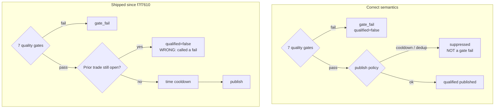

# Worklog — Qualified vs Suppressed: publish-path regression and redesign

**Date:** 2026-09-27  
**Repo:** `noble-trader-fastapi-backend`  
**Status:** **BUILT** (2026-09-27) — D1=15, D2–D5 approved; implementation §10 applied. Push is a separate gate.  
**Trigger:** last qualified signal &gt;15h while scans are healthy; user correction on cooldown semantics

---

## 1. Problem statement

Light sweeps are healthy (~56 rows/hour, 14 symbols). Last **published** qualified signal: **2026-09-26 11:45 UTC** (BTCUSD buy). Several near-win rows (GBPUSD sell p_win 0.80, EURUSD sell 0.77, AAPL buy ~0.56–0.60) clear every quality gate and are not published.

The system is **cutting quantity without improving quality**. That is a regression, not a quality filter working as intended.

Kairos + geometry work is designed to improve the quality of **S2+ subsequent signals within the same regime / timeframe**. It is not designed to suppress those signals. If S2 never fires because a prior signal is treated as an unresolved trade, the S2 research loop is starved.

---

## 2. Terminology (binding)

Use these words only. Do not say “blocked.”

| Term | Meaning | `qualified` column | `gate_outcome` |
|---|---|---|---|
| **Gate fail** | Failed one or more of the 7 quality checks | **`false`** | `gate_fail` |
| **Suppressed** | Passed **all** quality gates; not published for a non-quality reason (anti-spam cooldown, content dedup, live shadow veto) | **`true`** (quality verdict) *or* see §5.1 schema note | `suppressed` |
| **Qualified / published** | Passed all gates **and** published | `true` | `qualified` |

**Rules:**

1. **`qualified=false` is reserved for gate failures only.** Cooldown, open-prior, dedup, and shadow gates must **not** write `qualified=false`.
2. **Suppressed ≠ failed.** A suppressed row is evidence the gates liked the signal. Kairos evidence-pool work already depends on this (`20260926_CALIBRATION_EVIDENCE_POOL.md`: q+s pool ΔBrier −0.118 on S2).
3. **A signal is not a trade.** A qualified signal is a publish decision at time T. It does not “resolve.” Outcomes (TP/SL/expired) belong to the **paper trade / calibration record**, not to the publish gate. Exit/expiry must never gate whether a later signal may qualify.

---

## 3. Root cause (when the behavior changed)

| Item | Detail |
|---|---|
| **Commit** | `f7f7610` — 2026-09-08 — *Calibration/scoring reframe: consolidate bias, fix cooldown, fix bricks, meta-HMM v1* |
| **Worklog** | `20260909_CALIBRATION_AND_SCORING_METHODOLOGY_REFRAME.md` Follow-up #1 |
| **Directive then** | “after a sl/tp hits → the cooldown should restart” (XAUUSD example) |
| **What shipped** | `_probe_cooldown_restart`: if prior (symbol, direction) is **open**, set `qualified=False`, `suppress_reason=cooldown_open` — a hard veto regardless of elapsed time |
| **What was intended** | Restart the **wall-clock** cooldown timer after resolution — a time anti-spam rule, not an open-position publish veto |

Kairos V3 §12.1 already documents the correct model (`gate_outcome = qualified | suppressed | gate_fail`). The live orchestrator still overwrites `qualified` on cooldown, so the stamp vocabulary and the column disagree.



---

## 4. Evidence of regression

### 4.1 Suppression volume vs publish (stamps since 2026-09-24)

| Day | Passed quality but suppressed | Published |
|---|---|---|
| 2026-09-24 | 149 | 5 |
| 2026-09-25 | 90 | 8 |
| 2026-09-26 | 244 | 2 |
| 2026-09-27 (partial) | 35 | 0 |

(“Passed quality” here = p_win, regime_conf, effective_kelly, ev above thresholds on `suppress_reason in (cooldown_open, cooldown_time)` rows.)

### 4.2 Qualified rate by era

| Era | Rows/day | Published/day | qual % of directional |
|---|---|---|---|
| Aug 28–Sep 7 (5-min cadence, pre-cooldown_open) | ~3,000 | ~33 | 1.5–2.9% |
| Sep 9–23 (15-min + cooldown_open) | ~1,100 | ~10 | 0.8–1.1% |
| Sep 24–27 (G2 stamps + bracket/fail-closed) | ~1,200 | ~4 | 0.2–0.6% |

Volume drop (5→15 min) explains most of the **count** drop. The **rate** also fell. Cooldown_open plus gate-stack changes cut publish volume; quality of what still publishes has not measurably improved (G2.2 still NO PASS; p_win ranking IC≈0).

### 4.3 S2 starvation (Kairos-specific harm)

Kairos defines **S2 = the next qualified signal** (same-symbol follow-on, often same regime). Cooldown_open:

- Prevents S2 from existing while a prior paper position is open (AAPL open ~24h+, GBPUSD ~30h+).
- Marks gate-passing follow-ons as `qualified=false`, so they are **excluded from qualified S2 samples**.
- Evidence-pool and hourly-resolve levers need S2 volume; post-flip S2 n=0 has already held promotions (`20260926_LIVE_G22_DECISION_AND_PROMOTION.md`).

**Cutting quantity without quality gain blocks the very S2 loop Kairos/geometry are meant to improve.**

---

## 5. Design principles (new approach)

1. **Quality gates decide qualification.** The 7 checks + any live quality overlays are the only path to `qualified=true`.
2. **Publish policy may suppress, never fail.** Anti-spam may withhold delivery; it must not reclassify a gate-pass as a gate-fail.
3. **Signals do not resolve.** Trades resolve. Publish decisions are instantaneous. No exit/expiry coupling to later signals.
4. **Same-regime S2+ is first-class.** Later signals in a live regime are the Kairos/geometry target — evaluate them on quality (rank, geometry, freshness), do not veto them because a prior signal exists.
5. **Quantity with quality is success.** Fewer, worse publishes = regression. More gate-passing publishes with stable or better ΔD / Brier / W/L = progress.
6. **Research stamps never feed back as gates** (existing Kairos rule): `kairos_rank_score`, geometry shadow, etc. stay measurement until a separate promote decision.

---

## 6. Proposed architecture

### 6.1 Verdict model (single source of truth)

```
gate_pass     = all(quality gates)          # 7 checks + live quality overlays only
gate_outcome  = gate_fail                   if not gate_pass
              | suppressed                  if gate_pass and publish policy withheld
              | qualified                   if gate_pass and published
```

**Column semantics (schema/docs alignment — implementation note, not a migration until approved):**

| Field | Rule |
|---|---|
| `qualified` | `true` iff `gate_pass` (quality only). **Never** written false for cooldown/dedup/shadow. |
| `gate_outcome` | `gate_fail` \| `suppressed` \| `qualified` (as above). |
| `suppress_reason` | `cooldown_time` \| `content_dedup` \| `bracket_gate` \| `geometry_gate` \| … — **not** `cooldown_open` as a publish veto. |
| `failed_gates` | Non-empty **only** when `gate_outcome=gate_fail`. |

**UI / broadcast rule:** treat **published** (`gate_outcome=qualified`) as the user-facing “last signal.” Do not use `qualified=true` alone for Realtime/widget if suppressed rows also carry `qualified=true`. Prefer `gate_outcome='qualified'` (or an explicit `published` flag if we add one) for “last live signal.”

> Schema note: if `qualified` becomes “gate_pass,” consumers that today equate `qualified` with “published” must switch to `gate_outcome='qualified'`. That is a **contract change** — listed in §8, not assumed.

### 6.2 Publish policy (anti-spam only)

| Rule | Behavior when it fires | Classification |
|---|---|---|
| **Time cooldown** (`SIGNAL_COOLDOWN_MINUTES`, per symbol+direction) — **D1: lower from 60m** (recommend **15m**, see §8.1) | Withhold publish until T_last_publish + N | **suppressed** / `cooldown_time` |
| **Content dedup** | Identical payload already published | **suppressed** / `content_dedup` |
| **Open prior position / unresolved trade** | **REMOVED (D4/D5)** | n/a |
| **Exit / expiry / TP/SL** | **Not in the publish path** | n/a (resolver / scorecard only) |

**D2 (agreed):** clock is pure time from last **publish**. Do not restart from `resolved_at`.

### 6.3 S2+ quality within a regime (Kairos / geometry role)

Subsequent signals in the same regime/timeframe are **allowed to qualify**. Quality assistance is **forward-scoring**, not gating by prior trade state:

| Lever | Role on S2+ | Status |
|---|---|---|
| Event-time freshness (fresh vs deep) | Prefer / rank fresher follow-ons | T1 supported; research |
| Transition type (`dir_flip` etc.) | Rank / size overlay | Shadow |
| `kairos_rank_score` | Measurement; future rank gate | Shadow only — never live gate |
| Geometry / ATR payoff | Improve reachability & S2 quality | Replay-first track |
| Calibration evidence (q+s) | Correct S2 p_win | Shadow; promote bar held on thin S2 n |

**Implication:** removing cooldown_open **increases S2 sample size**, which is required for the post-flip promote bars (≥30 decided qualified S2, target ≥50). That is aligned with Kairos, not opposed to it.

### 6.4 What “qualified signals are not resolving in &lt;1h” means here

The current probe treats a gate-passing signal as something that must “close” before the next same-direction signal can exist. That conflates:

- **signal** = model verdict at T (instant),
- **trade** = paper lifecycle (entry → TP/SL/expired).

A 60-minute **anti-spam** interval is fine. An **unbounded wait on trade resolution** is not a publish policy — it is an implicit portfolio rule that the 7-gate design never included.

---

## 7. Remove / keep / change

### Remove (publish path) — D4 clean removal

1. `_probe_cooldown_restart` **`status=="open"` hard veto** (`orchestrator.py` ~4257–4267): do not set `qualified=False`, do not use `cooldown_open` as a publish suppressor.
2. All publish-path coupling of paper `open`/`close_ts`/outcome to a later signal’s qualification (D5).
3. `cooldown_open` as a suppress reason in the **gate/publish path** — removed cleanly, not left as a stamp (D4).
4. Language and logs that call suppression “blocked.”

### Keep

1. Seven quality gates (signal_qualifiable, regime_conf, kelly, TimesFM availability/confidence, ev, p_win) — unchanged thresholds unless a separate decision says otherwise.
2. Wall-clock anti-spam only — length **D1 (pending; 60m → 15m recommended)**.
3. Content dedup as **suppressed**.
4. Kairos stamps (`gate_outcome`, `suppress_reason`, `failed_gates`, `kairos_rank_*`) as measurement.
5. Resolver / expiry for **trade outcomes and calibration** only.

### Change (semantics) — D2/D3 agreed

1. `qualified` ⇔ gate_pass only.
2. `gate_outcome=suppressed` for anti-spam/dedup/shadow withhold.
3. `failed_gates` only on `gate_fail`.
4. UI “last signal” / broadcast = **published** (`gate_outcome=qualified`).
5. No resolve-restart of the cooldown clock (D2).

---

## 8. Decisions (user 2026-09-27)

| # | Question | Decision | Notes |
|---|---|---|---|
| **D1** | Time cooldown length | **15 min (option A)** | One publish per light-sweep slot. 60m rejected. |
| **D2** | Restart clock after trade resolve? | **No** (agreed) | Pure time from last **publish**. Exit/expiry never enter the publish path. |
| **D3** | `qualified` ⇔ gate_pass | **Yes** (agreed) | Contract change: UI/Realtime “last signal” = `gate_outcome='qualified'` (published). |
| **D4** | `cooldown_open` as stamp only? | **Remove cleanly from code** (agreed) | Not a stamp, not a suppressor. Delete the open-veto path and the publish-path use of `cooldown_open`. Research can reconstruct “prior open” offline if ever needed. |
| **D5** | Same-dir S2 while paper position open? | **Allow** (agreed) | Signal ≠ trade. S2+ is the Kairos/geometry target. |

### 8.1 D1 — why 60m should drop (Kairos + cadence)

**What Kairos actually showed (binding against “wait because the regime is aging”):**

| Result | Finding | Implication for cooldown |
|---|---|---|
| **V4 regimes age** | Exit hazard **flat 0.09–0.13/h** on 1h labels; KS vs geometric 0/5. Memoryless. | Remaining life does **not** depend on age. A signal at T+61h is not “too late” because of age. No age-based silence. |
| **V2 edge decay** | Disproved for ages &lt;24h (slope sign unstable, p 0.46). | No evidence that edge dies within the hour after a prior signal. |
| **S1/S2 regime-context** | Disproved on 1h labels. | Not a reason to hold S2 until S1’s trade closes. |
| **Fresh band** | `fresh` 0–3h is best for *regime identification*, not a publish veto. | Prefer/rank fresher follow-ons; do not suppress strong later ones. |
| **Trade resolve times** | Median TP ~26h, SL ~28h; ~1% in 6h. | A 60m window is not tied to trade resolution quality. |

**Noise is already controlled:**

1. Light sweep every **15 min** → at most one new score per symbol per slot.  
2. Content dedup still suppresses identical reprints (`content_dedup`).  
3. Quality gates (7 checks) are the real filter.  
4. After cadence 5→15 min, **60m = four skipped slots** of gate-passing signal — pure quantity loss with no measured quality gain.

**D1 options:**

| Option | Value | Effect | Fit |
|---|---|---|---|
| **A (recommended)** | **15 min** | One publish per sweep slot per (symbol, direction). Same as cadence; no extra silence. | Aligns anti-spam with scan noise floor. |
| B | **0** | Every gate-pass publishes (slots still 15 min apart). | Maximum S2 sample; relies on gates + dedup only. |
| C | 30 min | Two slots skipped when hot. | Still arbitrary vs Kairos. |
| D (status quo) | 60 min | Four slots skipped; historically paired with open-veto. | **Reject** — not justified post-15-min cadence. |

**Recommendation:** **D1 = 15 minutes** (option A). Optional later: quality-conditional bypass (publish inside cooldown if `kairos_rank_score` / p_win ≥ bar) — **not** in this change; rank stays shadow.

If you prefer maximum S2 throughput for promote bars, **D1 = 0** is also coherent; 15m is the conservative default that still removes the hour-scale drought.

---

## 9. Success metrics (how we know the regression is gone)

| Metric | Pre-fix (recent) | Target |
|---|---|---|
| Published qualified / day | ~2–8 | Recover toward **historical ~8–15/day** at 15-min cadence (not 1980s 5-min volume) |
| Suppressed-as-gate-fail | `qualified=false` on cooldown rows | **0** — cooldown only `gate_outcome=suppressed` |
| Hours since last publish | 15h+ droughts | p90 gap **&lt; 4h**; max gap tracked |
| S2 sample (qualified follow-ons) | n=0 post-flip | ≥30 decided S2 for promote bars |
| Quality | G2.2 NO PASS; p_win IC≈0 | No claim of quality win from this change alone — this change **restores quantity so quality can be measured** |

**Explicit non-goal:** this redesign does **not** by itself raise win rate or ΔD. It removes a false gate so quality work (Kairos, geometry, calibration) can act on a representative S2 stream. Quality promotion stays on existing bars (ΔD, Brier, W/L vs odds).

---

## 10. Implementation sketch

**Status:** D2–D5 approved (user 2026-09-27). **D1 pending** (§8.1). **Build authorized only after D1 is set** (or explicit “build with D1=A” / “D1=B”).

1. **Remove D4 cleanly:** delete `_probe_cooldown_restart` open-veto branch and every publish-path use of `cooldown_open` / prior-open status. No leftover stamp, no dead probe call in the gate path. Keep resolver outcome logic only where trades/calibration need it (not the publish gate).
2. **Verdict helper:** `gate_pass` first; then `qualified` / `gate_outcome` / `suppress_reason` / `failed_gates` per §6.1. Never `qualified=false` for suppress.
3. **Time cooldown only:** `SIGNAL_COOLDOWN_MINUTES` = D1 value (15 recommended); fire → `gate_outcome=suppressed`, `suppress_reason=cooldown_time`.
4. **Broadcast + `last_signal_at`:** published = `gate_outcome='qualified'`. Align nobletradingapp health/Realtime with that contract (D3).
5. **Tests:** open prior does not affect `qualified`; suppress ≠ fail; `failed_gates` empty on suppress; cooldown is wall-clock only.
6. **Docs/logs:** drop “blocked”; update AGENTS.md / scope §12 if needed.
7. **Post-deploy (48h):** published vs suppressed vs gate_fail counts; S2 volume; gap distribution.

**Not in this batch:** kairos_rank live gate, quality-conditional cooldown bypass, geometry promote.

---

## 11. Related

| Doc | Why |
|---|---|
| `worklog/20260909_CALIBRATION_AND_SCORING_METHODOLOGY_REFRAME.md` | Introduces cooldown-restart (overreach) |
| `worklog/kairos/scopes/20260924_KAIROS_V3_SCOPE.md` §12 | Correct `gate_outcome` vocabulary |
| `worklog/kairos/20260926_CALIBRATION_EVIDENCE_POOL.md` | q+s evidence improves S2 |
| `worklog/kairos/20260926_LIVE_G22_DECISION_AND_PROMOTION.md` | S2 n=0 holds promotions |
| `regime_platform/sweep_orchestrator/orchestrator.py` | `_probe_cooldown_restart`, cooldown block ~4225–4292 |
| `tests/test_cooldown_restart.py` | Current tests encode open-veto behavior |

---

## 12. Approval checklist

- [x] Terminology accepted (suppressed; `qualified=false` only on gate fail) — user 2026-09-27
- [x] D1 = **15 min** (option A)
- [x] D2 — no restart after resolve
- [x] D3 — `qualified` ⇔ gate_pass; UI uses `gate_outcome`
- [x] D4 — remove `cooldown_open` from code cleanly
- [x] D5 — allow same-dir S2 while a paper position is open
- [x] Authorized to implement §10 — **built 2026-09-27**
- [x] `qualified` consumer contract: DB column = gate_pass; Discord/last-publish use `published` / `gate_outcome=qualified`
- [ ] Push gate separate

### Shipped (2026-09-27)

| Change | Where |
|---|---|
| `signal_cooldown_minutes: 15` (default + YAML) | `config/feature_flags.yaml`, `feature_flags.py` |
| Wall-clock cooldown only; suppress never flips `qualified` | `orchestrator.py` publish-policy block |
| `CooldownRestartProbe` / `_probe_cooldown_restart` **deleted** | `orchestrator.py` |
| Dedup / bracket / geometry → `published=False`, `suppress_reason=*` | `orchestrator.py` |
| Discord + cooldown timer use `published` | `orchestrator.py` |
| `nt_signal_sim.qualified` = `_gates_pass` | `orchestrator.py` |
| `gate_outcome`: qualified=published · suppressed=gate_pass∧¬published · gate_fail | `orchestrator.py` |
| Tests rewritten | `tests/test_cooldown_restart.py`, `test_kairos_capture.py` |

**Verification:** full suite `1314 passed, 21 skipped`.
