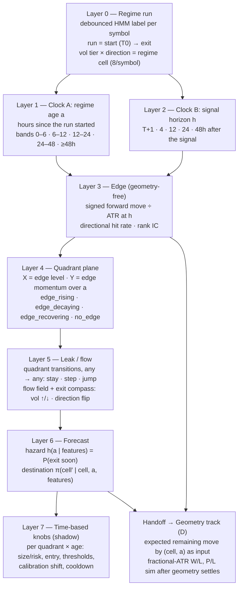
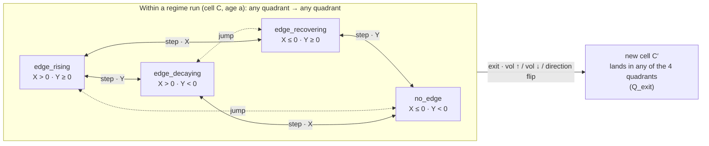

# KAIROS v3: dual-timeline regime model (scope)

**2026-09-24 · scope / design only.** No code, config, schema, or live behaviour changes. The name
stays **Kairos** (user decision 2026-09-24). Flags and artefacts use the `kairos_` prefix. This
supersedes the thesis and plan in `worklog/kairos/scopes/20260923_KAIROS_EDGE_STATE_SCOPE.md`. Its
terminology, statistical rules, and retention change carry forward. Canonical visual:
`worklog/kairos/assets/20260924_edge_plane_concept.html` (user-confirmed as the representation of the thesis).

---

## 1. Plain-language explanation

Every symbol is always in some market regime (volatility tier × direction). A regime has a
**start**, a **life**, and an **exit** into a new regime. The v3 thesis is that our signal's
edge inside a regime is not constant: it has a shape over the regime's life. We can see:
- **where** the edge is (which quadrant);
- **which way it is drifting** as the regime ages;
- **where it is likely to leak to** when it ends (vol up or down, direction flip).

Read it like a scatter plot that moves. Each symbol-regime is a point on a quadrant chart. As
the regime ages, the point travels, and its path shows the decay and the direction of the leak.
The path is **not a fixed cycle**. The point can stay put, move to a neighbouring quadrant,
move back the way it came, or jump diagonally in one go (for example straight from
`edge_rising` to `no_edge` on a shock or a regime exit). Which moves actually happen is measured,
not assumed.

The work splits into three separate jobs that must not be mixed:

| Job | Question | What it may use | What it must not use |
|---|---|---|---|
| **A. Find edge and decay** (this scope) | Is there an edge, where is it, how does it decay over time, and where does it leak? | Price paths and regime labels only (geometry-free) | R, win/loss, P/L, TP/SL/expiry shares, SL/TP counterfactuals |
| **B. Forecast the regime** (this scope) | When does the current regime end, and into what? | Regime labels and market features | Anything outcome-based |
| **C. Time-based tuning knobs** (this scope, shadow only) | What should change with quadrant × regime age? | Outputs of A and B | SL/TP tuning |
| **D. Geometry** (separate user-owned track) | Brick / SL / TP / fractional ATR, and W/L and P/L simulation | Receives A and B's curves as inputs later | — |

---

## 2. Thesis v3

> **For each symbol, inside each regime, how does our signal's edge evolve on two clocks: from
> regime start to regime exit, and from signal to T+48h? Which way is it leaking, and can we
> forecast the exit and its destination well enough to set time-based knobs per quadrant?**

Four questions, each answered geometry-free:
1. **Edge and decay.** Can a matrix plus time locate the edge and its decay? (User position: yes.)
2. **Forecast.** Can we forecast the next regime, both when and where to?
3. **Knobs.** Which time-based knobs (risk up or down, entry, thresholds, calibration) apply per quadrant × age?
4. **What's missing.** See §8, which is built into the design as constraints.

---

## 3. The model: layered dimensions

### 3.1 Layer 0: regime run
- The unit is a **run**: consecutive hours with the same debounced regime cell for a symbol.
- The run's start is T0. The first hour in a different cell is the exit, and its destination cell is recorded.
- Strength (strong vs weak) is kept as an attribute, not a row, because 16 cells are too thin.
- Vol tiers are also anchored to **fixed ATR percentiles** per symbol. HMM state names are relative to a rolling fit, so "med_high_vol" can drift in meaning (§8.2).

### 3.2 Two clocks
- **Clock A (regime age, a):** how old the regime is when a signal fires. This measures staleness.
- **Clock B (horizon, h):** how far after the signal we look. This measures the edge's shape: when it peaks and how fast it fades.
- Every edge value is indexed by both: **edge(cell, a, h)**.

### 3.3 Layer 3: geometry-free edge
For a signal with direction d (+1 buy / −1 sell) at price P₀ with ATR₀, and close P_h at horizon h:

- **Signed move:** `m_h = d · (P_h − P₀) / ATR₀`
- **Edge level:** mean of m_h, or median (BTC-type fat tails dominate means).
- **Directional hit rate:** share of m_h > 0, taken as excess over the symbol's own base rate.
- **Rank IC:** Spearman correlation of d against the forward return, per cell.
- **Edge curve:** edge(h) for h ∈ {1, 4, 12, 24, 48}. Its peak h\* and half-life are the time shape.

None of these depend on brick size, SL, TP, or expiry.

### 3.4 Layer 4: quadrant plane (geometry-free redefinition)
The v2 quadrants were built from rolling R, which is geometry-dependent. v3 rebuilds the same
four boxes from geometry-free coordinates:

- **X (edge level):** edge(cell, h = H_ref) over recent signals. H_ref is pre-registered at 24h.
- **Y (edge momentum):** the change in edge level with regime age within the current run, plus
  the recent-vs-longer window comparison (both computed; one chosen before confirmation).

| | Y ≥ 0 (strengthening) | Y < 0 (weakening) |
|---|---|---|
| **X > 0 (edge present)** | `edge_rising` | `edge_decaying` |
| **X ≤ 0 (no edge)** | `edge_recovering` | `no_edge` |

### 3.5 Layer 5: leak and flow (the "moving scatter plot")
Each (symbol, run) traces a **trajectory** on the plane as its age grows.

**No cycle is assumed.** The v2 "rotation" (`edge_rising` → `edge_decaying` → `no_edge` →
`edge_recovering` → back) was shown to be a rolling-window artefact (v2 scope, below-null
transitions), and nothing forces the point to visit the quadrants in order. Between two age bands
the point can make any of three kinds of move:

| Move | Axes crossed | Examples | Count |
|---|---|---|---|
| **Stay** | none | `edge_rising` → `edge_rising` | 4 |
| **Step** (either direction) | X or Y | `edge_rising` → `edge_decaying`, and also back: `edge_decaying` → `edge_rising` when the edge re-strengthens | 8 |
| **Jump** (diagonal) | X and Y in one band | `edge_rising` → `no_edge` (edge collapses at once), `no_edge` → `edge_rising`, `edge_decaying` ↔ `edge_recovering` | 4 |

The old fixed cycle covers only 4 of the 12 non-stay moves. All 16 entries are estimated, and none
is set to zero in advance.

There are two kinds of leak, and both use the same any-to-any structure:

1. **Within-run movement:** the point moves while the regime holds.
   - Measured as a **quadrant transition matrix** `Q_within(q → q′ | C, age band)`, 4 × 4.
   - Plus a **flow field**: the average velocity vector (ΔX, ΔY) at each plane location and age band.
   - **Caveat:** a mean vector can hide jumps. Averaging a few large diagonal jumps with many stays
     gives a small step that never actually happens. So each plane location also keeps its
     displacement distribution (at least the stay / step / jump shares and the jump direction),
     not only the mean.
2. **Exit leak:** the regime ends and the symbol lands in another cell, which has its own (already
   known) quadrant. The landing quadrant can be **any** of the four, including the diagonal one.
   - Measured as an **exit compass** per cell and age band: P(vol ↑), P(vol ↓), P(direction flip),
     P(vol and direction both change).
   - Plus `Q_exit(q → q′ | C, age band, exit direction)`, the quadrant the symbol lands in.

The labels-only decomposition (below) suggests most diagonal jumps happen at regime exits. Jumps
inside a run (event shocks, for example) are still kept and measured separately.

Solid lines are steps (one axis), dotted lines are jumps (both axes). Every line runs both ways.
Staying in the same quadrant is always possible and isn't drawn.

Concept illustration (schematic, no data): `worklog/kairos/assets/20260924_edge_plane_concept.html`.

The 2026-09-23 decomposition (5-symbol TDVA reconstruction, labels only) found about 78% of
symbol-level edge-state changes and about 83% of diagonal jumps coincide with a regime-cell
change. That result used the old R-based states. It motivates this layer but must be re-derived
on the geometry-free plane.

### 3.6 Layer 6: forecast (when and where)
The HMM is **memoryless**: its chance of leaving a regime is the same at hour 2 and hour 40, so
its run lengths are geometric. The thesis says regimes age, so v3 uses a **duration (hazard)
model**, in the hidden semi-Markov family:

- **Hazard:** `h(a | x)` = P(the run ends in the next hour | age a, features x).
- **Survival:** `S(Δ | a, x)` = P(the run is still alive Δ hours from now).
- **Destination:** `π(C′ | C, a, x)`.
- **Next-quadrant forecast:** two routes, both any-to-any.
  - If the regime exits: `Σ_C′ π(C′ | C, a, x) · 1[quadrant(C′) = q]`.
  - If it holds: `Q_within(q_now → q | C, a)`.
  - Combined with the hazard: `P(q) = H · P_exit(q) + (1 − H) · Q_within(q_now → q)`, where H is the exit probability over the forecast window.
  - No transition is ruled out because it skips a quadrant.
- **Candidate features (x):** the market-movement factor families in §3.8 (momentum, trend
  quality, volatility/range, tick-volume activity and flow, liquidity, cross-asset/breadth,
  multi-timeframe, calendar/session), always tested **against an age-only baseline**.
- **Baseline to beat:** the HMM's own transition matrix (the source of `p_markov_hold_n`). Scored
  on labels only with log-loss and Brier, per symbol, out of sample.

### 3.7 Layer 7: time-based knobs (derived, not fitted per cell)
Fitting each knob separately in every (symbol × cell × quadrant × age) cell would overfit.
Instead, knobs are derived from two curves:

- **Survival-weighted expected edge:** `E(C, a) = Σ_h edge(C, a, h) · S(h | a, x)`.
- **Leak risk:** `L(C, a)` = P(the plane point reaches `no_edge` within 24h, whether by a step, a
  direct jump, or an exit into a `no_edge` cell). The direct-jump share is reported separately
  because it gives no warning through `edge_decaying`.

| Knob | Rule shape (to be fixed at P3) | Direction of effect | In scope? |
|---|---|---|---|
| Risk / size multiplier | ∝ E(C, a), shrunk by L(C, a) | Less risk as the regime ages or leaks; more in a fresh `edge_rising` | ✅ shadow |
| Entry allowed | Off when E ≤ 0 or L above a threshold | Blocks late-regime entries | ✅ shadow |
| Gate thresholds (regime_conf, p_win) | Rise with a and L | Demand more certainty late in a run | ✅ shadow |
| Cooldown / re-entry spacing | Lengthens with a | Fewer stacked entries in stale regimes | ✅ shadow |
| `p_markov_hold_n` source | Age-aware hazard replaces the memoryless HMM hold probability | Calibration input to the EV blend | ✅ shadow (via the existing shadow pattern) |
| Max hold / expiry | Peak h\* of edge(h) | Time knob, but it changes outcomes | ➜ handed to geometry track |
| SL / TP / brick | — | — | ❌ geometry track only |

### 3.8 Market-movement factors (no order book): what's available and what feeds which layer

**Data reality (probed live 2026-09-24):**

| Source | Endpoint | What it gives | History | Use in Kairos |
|---|---|---|---|---|
| 1h OHLC**V** candles | `POST /api/price/batch` (already used by the sweeps) | open/close/max/min **plus `volume`** on every bar | 2025-01-01 onward (BTC 2026-01-01; AAPL 2023) | ✅ Primary. Every factor below is computed from this. **`price_fetcher.py` currently discards `volume`.** |
| Volume type per symbol | `info.volume_type` on the same response | OANDA FX / metals / US30 = **tick** · Coinbase BTC = **base** (real traded units) · Pepperstone US500 = unspecified (broker ticks) · AAPL = exchange volume | Non-zero on 100% of bars for all 14 symbols | Treat as an **activity** measure, normalised per symbol and hour-of-week, never compared across symbols |
| 4h / D candles | same endpoint, timeframe 240 / D | OHLCV | 4h from 2023, D from 2022 | Higher-timeframe regime and its age |
| Economic calendar | `GET /api/calendar/economic?from=<unix>&to=<unix>` (unix only; date strings return `no_data`) | title, country, currency, importance (−1/0/1), actual / forecast / previous, timestamp | 2025-01-01 onward confirmed; about 17 importance-1 events/week (FOMC, CPI, NFP, retail sales, PMIs…) | ✅ Event proximity and **surprise** (actual − forecast) |
| Real-time quote | `GET /api/quote/{sym}` | bid, ask (bid/ask size = 0 on OANDA, so no depth), session volume, average volume | **Live only, no history** | Spread at signal time (start capturing it; history uses OHLC spread estimators) |
| TA snapshot | `GET /api/ta/{sym}`, `/api/ta/{sym}/indicators` | 81 indicators (RSI, ADX, MACD, Stoch, pivots…) and TradingView recommend scores | **Snapshot only. The `timeframe` parameter is ignored** (identical values for 60/240/1D) | ❌ Not a research input. At most a live sanity cross-check; we compute every indicator ourselves from OHLCV |
| Order book / depth | — | Not available | — | ❌ Replaced by the flow proxies below |

**Is tick volume usable?** A secondary source cites a vendor study that found hourly EURUSD /
USDJPY / GBPUSD tick counts correlate with ECN traded volume at r ≈ 0.96–0.99
(backtestmarket.com, citing fxvolume). The agreement weakens outside liquid sessions and below
1h aggregation. So: 1h aggregation, per-symbol, hour-of-week normalisation, and never as a
money-flow amount. This is indicative, not a primary source; **V7 tests usefulness directly** instead of assuming it.

**Factor catalogue.** All are geometry-free, computable at time t from bars ≤ t, and normalised
per symbol (ATR units, or percentile vs the symbol's own trailing distribution).

| Family | Factors | What it should tell us | Layer it feeds |
|---|---|---|---|
| **Momentum** | ROC in ATR units (1h / 4h / 24h); momentum acceleration (Δ ROC); stretch = distance from EMA20/50 in ATR | Is the move still pushing, or decelerating? | Plane Y (momentum), hazard |
| **Trend quality / persistence** | Kaufman efficiency ratio (net move ÷ path length); ADX / DI spread from OHLC; variance ratio; rolling DFA-Hurst (used cautiously; it can mislabel random walks) | Clean trend vs chop; persistence fading = exhaustion | Hazard (exit timing), edge modifier |
| **Run geometry** (distances only, not SL/TP) | Distance travelled since T0 in ATR; share of bars in run direction; deepest pullback within run in ATR; bars since run extreme | How "used up" the regime is | Hazard, direction-flip compass |
| **Volatility / range** | Range-based realised vol (Parkinson, Garman-Klass, Rogers-Satchell); ATR now ÷ ATR at T0 (expansion); Bollinger bandwidth percentile / NR7 (compression); vol-of-vol | Compression precedes vol-↑ exits; expansion late in a run precedes exhaustion | Compass (vol ↑ / vol ↓), hazard |
| **Activity (tick volume)** | Relative volume vs same hour-of-week baseline; volume trend within the run (slope); volume at run start vs now | Participation rising or drying up | Hazard, compass (vol ↓ when volume dries up) |
| **Flow proxies (order-book substitute)** | Close-location value CLV = ((C−L) − (H−C)) ÷ (H−L); CLV × relative volume (accumulation/distribution, Chaikin money flow); OBV slope in the run; effort vs result = relative volume ÷ \|move in ATR\| (Wyckoff/VSA); upper/lower wick share (rejection) | Pressure behind the move; divergence = price extending on falling effort; rejection wicks against the run | Direction-flip compass, plane Y |
| **Liquidity / cost** | Corwin–Schultz and Abdi–Ranaldo spread estimators from OHLC (history); live bid/ask spread (from now on); Amihud-style \|return\| ÷ relative volume | Whether a small edge survives costs; thin-liquidity hours | Edge reported in spread units (§8.9), knob guard |
| **Cross-asset / breadth** | Synthetic USD index from the 6 FX majors in the universe; symbol's residual vs that USD factor; cluster breadth (share of cluster-mates in the same direction and their regime ages); US500 as risk-on/off; existing `core/correlation_regime.py` rolling correlation | Is this a symbol move or a USD / risk move? USD regime changes shift the FX majors together | Destination compass, portfolio layer (§8.5) |
| **Multi-timeframe** | 4h and D regime labels and their ages (same HMM, higher timeframe) | A young higher-timeframe regime is a different state from an old one | Hazard, destination |
| **Calendar / session** | Hours to next / since last importance-1 event for the symbol's currencies; surprise = (actual − forecast) ÷ historical surprise stdev; session (Asia/London/NY/overlap); day of week; month-end / London 4pm fix | A large share of exits may simply be scheduled | Hazard (first test after age), compass |

**How the factors are tested, one family at a time:**
- **Collinearity.** Many families are correlated with regime age (a stretched, low-efficiency,
  volume-drying run is usually an old run). Each family is scored on what it adds **beyond an
  age-only model**, in the fixed order: calendar/session → volatility/range → momentum + trend
  quality → activity + flow → multi-timeframe → cross-asset.
- **Stop at the first plateau.** A family that adds nothing out of sample is dropped, not tuned.

---

## 4. Current state (what exists)

| Item | Status | Implication for v3 |
|---|---|---|
| Debounced regime label | `regime_label_debounce_mode: live` since 2026-09-22 (3 ticks). In live mode the debounced label **is** what is persisted as `nt_signal_sim.regime` (`orchestrator.py` ~2985–3006) | Runs from 2026-09-22 onward are usable for Clock A |
| Debouncer state | In memory, one per symbol; a cold start accepts the first raw read | A Studio restart can create an **artificial run break**. The run view must flag breaks that coincide with restarts |
| Geometry-free forward moves (live) | `drift_1h_pct`, `drift_4h_pct`, `drift_24h_pct` on every resolved row. They are signed, taken from `closes[:48]` regardless of exit, and independent of SL/TP (`eod_resolver._drift_fields`) | h = 1/4/24 already exist. **h = 12 and 48 are missing.** The window holds 48 bars, so index 48 needs one more bar |
| `mfe` / `mae` | Walked only until the bracket exit (`eod_resolver.py:301`) | **Bracket-truncated, so geometry-dependent.** Excluded from v3 |
| Retention | `signal_sim_retention_resolved_days: 120` (config, committed `a99d873`, pending Studio update) | Needed: the post-debounce history must not be deleted at 30 days |
| TDVA 1h history | 2025-01-01 onward (BTC from 2026-01-01); full OHLC path | Geometry-free edge curves can be computed for any h. Reconstructed labels (cold fit per bar) flap: 98% of cell runs are shorter than 6h, so Clock A needs the recon labels passed through the same debouncer (§6 P1) |
| HMM transition matrices | `RegimeHMM` exposes `transmat_` for vol and trend; `trend_transition_matrix_3state()` | This is the memoryless baseline for Layer 6 |
| Research tooling | `regime_cell_edge_persistence.py`, `reconstruct_signal_history.py` (`FastPanel`, circular-shift null), `edge_state_gate_test.py` | Reusable for the plane and nulls. Their R-based outputs are **not** v3 evidence |
| Tick / base volume | Present on every TDVA 1h bar for all 14 symbols (probed 2026-09-24). `price_fetcher.fetch_tradingview_batch` returns closes only and **drops `volume` and the OHLC**. `nt_signal_sim` stores no volume | Activity / flow factors need OHLCV. Research reads TDVA directly; live capture needs `price_fetcher` to keep OHLCV (P0.5) |
| Economic calendar | `GET /api/calendar/economic` (same RapidAPI key), history to 2025-01-01, importance −1/0/1, actual / forecast / previous | Calendar/session family is available on existing credentials. No new vendor |
| Live bid/ask | `GET /api/quote/{sym}` (bid, ask; sizes 0 on OANDA) | Spread capture from now on; history must use OHLC spread estimators |
| Withdrawn | 2026-09-24 worklog §2–§3 (R-based age decay, `age_mult` / `state_mult`) | Kept for history only |

---

## 5. Pre-registered hypotheses (geometry-free)

### 5.0 Frozen definitions (P0.1: frozen 2026-09-24, before any P1 run; user "#2 freeze")

| Item | Frozen definition |
|---|---|
| Signal | One per completed 1h bar t: direction d = +1 if the HMM trend label contains "bull", −1 if "bear". Entry = close[t] |
| ATR | Production `heavy_sweep.compute_atr` (mean \|ΔC\| over the last 14 closes, bars ≤ t) |
| Edge measure | m_h = d · (C[t+h] − C[t]) / ATR_t, h ∈ {1, 4, 12, 24, 48} **bars** (same bar convention as live `drift_*_pct`). Geometry-free |
| H_ref | 24 bars |
| Regime cell | vol tier × direction from the label (`kairos.regime_cell`), 8 per symbol |
| Labels (reconstruction) | Cold-fit production `RegimeHMM` per bar (existing `.cache/recon_*_labels.json`), then passed through `RegimeLabelDebouncer` with n_confirm ∈ {1..6} chosen to match the live post-debounce hourly cell flip rate (**0.474/h**, measured 2026-09-22 12:00 → 09-24 04:46, 14 symbols, 2,202 ticks) |
| Run | Consecutive bars with the same cell. Breaks on a cell change or a timestamp gap > 3h. A run starting after a gap is left-censored (excluded from V4). The last run before a gap or data end is right-censored |
| Regime age a | Hours since the run's first bar (bar timestamps) |
| Age bands | 0–6, 6–12, 12–24, 24–48, ≥ 48h |
| Plane X | For cell c at bar t: shrunk mean of m_24 over the symbol's signals in c with s + 24 ≤ t (resolved) and ts_s ≥ ts_t − 14d. Shrinkage k = 10 toward the symbol's all-cell mean over the same window. Defined only if n14 ≥ 10 and n7 ≥ 5 |
| Plane Y | X7 − X14 (the same estimator on 7d vs 14d windows). The age-slope alternative is reported as secondary only |
| Edge state | X > 0 & Y ≥ 0 `edge_rising` · X > 0 & Y < 0 `edge_decaying` · X ≤ 0 & Y ≥ 0 `edge_recovering` · X ≤ 0 & Y < 0 `no_edge` |
| Trajectory / flow | Symbol-level point P_t = (X, Y) of the symbol's current cell. Step v_t = P_{t+1} − P_t (no gap). Region = edge state of P_t |
| Null | **Circular shift of the label sequence (cell, direction, run, age together) vs the price sequence**, offset ≥ 336 bars (14d), per symbol, 1,000 draws. m, plane, flow and all statistics are recomputed per draw. Preserves label run structure, price autocorrelation and window mechanics; breaks timing |
| CIs | Cluster bootstrap over symbol-days, 2,000 draws |
| Discovery symbols | EURUSD, XAUUSD, US500, BTCUSD, USDJPY (one per correlation cluster; BTC from 2026-01-01) |

**Frozen readings of V1–V4 (P1):**
- **V1:** pass if, for some h ∈ {4, 24}, the pooled mean m_h has a cluster CI lower bound > 0 **and** a circular-shift p < 0.05. p_V1 = 2 · min_h max(p_CI, p_null).
- **V2:** OLS slope of m_24 (demeaned within symbol) on log(1 + a_cell). Pass if the cluster CI < 0 **and** the per-symbol slope is < 0 in ≥ 3 of 5 symbols.
- **V3:** regional mean-velocity magnitude \|v̄_r\| vs the circular-shift null. Pass if ≥ 2 of 4 regions have Holm-adjusted p < 0.05.
- **V4:** discrete-time logistic hazard of run end on log(1 + a). Pass if the pooled slope CI > 0 (rising hazard) **and** a KS test against a geometric distribution (parametric-bootstrap p) rejects in ≥ 3 of 5 symbols.
- The P1 family is Holm-adjusted over V1–V4. Final confirmation uses Holm over V1–V7.
- **Amendment before the first P1 run (2026-09-24, no results seen):** the debouncer mechanically
  prevents a run from ending before n_confirm bars. An unconditional hazard would therefore rise
  by construction. V4's hazard and KS test use the clock shifted by n_confirm − 1 (conditional on
  surviving the debounce minimum) and a shifted-geometric reference. Signals in left-censored runs
  (unknown true age) are excluded from V2 and the age tables.
- **Amendment 2 (2026-09-24, disclosed as post-smoke):** a 20-draw smoke run at the auto-chosen
  n_confirm 1 was run, and its V1–V4 output (all fail) **was seen** before this decision. The
  calibration table shows no n_confirm matches the live rate on hourly bars (n=1 → 0.665/h,
  n=2 → 0.110/h vs live 0.474/h), because live debounces 15-minute ticks. n=1 is nearer in rate
  but is effectively undebounced: 98% of signals fall in the 0–6h band, so the age tests (V2/V4)
  have no old-regime data. **Both are reported, with n_confirm 2 as primary for the age tests
  (V2, V4) and n_confirm 1 as primary for V1/V3** (the settings where each test has data). This
  is a forking-path risk and is flagged as such. Any P1 "pass" here is exploratory until the
  live debounced confirmation data (G2) repeats it.

- **Discovery data:** TDVA reconstruction (debounced labels, §6 P1) plus live data before 2026-09-22.
- **Confirmation data:** live, debounced, 2026-09-23 onward.
- **Statistics:** symbol-day cluster bootstrap; circular-shift null for anything built on rolling
  windows; excess over each symbol's base rate; Holm correction across V1–V7.

| ID | Hypothesis | Test | Pass |
|---|---|---|---|
| V1 | The signal has directional edge inside regime cells | edge(C, h) for h ∈ {4, 24}: median m_h and hit rate excess, per cell pooled across symbols | CI > 0 in at least one h, beats the circular-shift null |
| V2 | Edge decays with regime age | Slope of edge(C, a, h = 24) on log(1 + a) | Slope CI < 0 pooled; same sign in ≥ 3 of 5 recon symbols |
| V3 | Movement on the plane has structure (it isn't noise) | The 4 × 4 matrices `Q_within` and `Q_exit` (all 16 entries, no cycle order assumed), plus the flow field, vs the same trajectories with the age order circularly shifted | Q differs from the null (permutation test over all 16 entries) in `Q_within` or `Q_exit`, **or** flow magnitude beats the null in ≥ 2 plane regions. The v2 cycle order is reported only as a descriptive comparison |
| V4 | Regimes age (the exit hazard is not memoryless) | Run-length distribution vs geometric; hazard slope in a | Hazard rises with a (CI > 0) and a KS test rejects geometric, per symbol, on debounced labels |
| V5 | Exit time and destination are forecastable beyond the HMM | Hazard + destination model vs HMM `transmat_`, log-loss / Brier out of sample | Improvement CI > 0 pooled; no symbol materially worse |
| V6 | Time-based knobs would have moved risk the right way | Shadow E(C, a) vs realised geometry-free edge on the next signals (rank correlation) | Spearman > 0, CI excluding 0, over the 4-week shadow |
| V7 | Market-movement factors add forecast information beyond regime age | Each §3.8 family added in the fixed order to the age-only hazard / destination model; out-of-sample log-loss / Brier change | A family is kept only if its improvement CI > 0 pooled. Families are reported individually; no symbol materially worse |

W/L, P/L and R are **not** pass criteria anywhere in V1–V7.

---

## 6. Plan

### P0 — Foundations (no behaviour change)
1. **Freeze definitions:** edge measure, H_ref = 24h, age bands, plane axes, and ATR-percentile vol anchors.
2. **Regime-run view (VIEW, not table):** `v_regime_runs` over `nt_signal_sim` sweep-light rows since 2026-09-22.
   - Built with gaps-and-islands on (symbol, cell) using the first tick per hour.
   - Columns: run_id, symbol, cell, strength mix, started_at, ended_at, length_h, exit cell, and a restart-break flag.
3. **Two more geometry-free horizons:** add nullable `drift_12h_pct` and `drift_48h_pct`.
   - Capture them in `eod_resolver._drift_fields`; the 48h value needs the window extended by one bar.
   - Schema change is `ALTER TABLE nt_signal_sim ADD COLUMN`, the same pattern as the existing shadow columns. No new table.
4. **Retention:** the 120-day config goes live with the Studio update (already committed).
5. **Market-movement inputs, live capture** (nullable columns on `nt_signal_sim`, no new table):
   - `price_fetcher` keeps the OHLCV it already receives (today it returns closes only). Callers
     keep their current return shape; the extra fields go on an opt-in path like
     `include_timestamps`.
   - At signal time, stamp: `rel_volume_1h` (vs same hour-of-week), `clv_1h`, `efficiency_24h`,
     `atr_ratio_run`, and live `spread_bps` (from `/api/quote/batch`, one call per ≤ 10 symbols per sweep).
   - The exact column list is frozen at P0.1 and limited to what the P1 discovery needs for confirmation.
6. **Event calendar cache:** a daily pull of `/api/calendar/economic` (importance ≥ 1, the
   universe's currencies) into a config/cache file for research. A table is only considered if
   live stamping of event proximity is approved later.

### P1 — Discovery (offline, geometry-free)
5. **Debounced reconstruction labels:** pass the TDVA labels through `RegimeLabelDebouncer`, with
   n_confirm chosen so the reconstruction's flip rate matches the live post-debounce flip rate.
   This fixes the compressed Clock A.
6. **Edge curves** edge(C, a, h) per symbol and pooled, using a hierarchical estimate (symbol
   deviates from pooled only where n supports it).
7. **Factor panel:** compute the §3.8 catalogue from TDVA OHLCV (1h, 4h, D) plus the calendar,
   point-in-time, per symbol. It is a read-only research script that joins onto the run panel.
8. **Quadrant plane:** trajectories, `Q_within` / `Q_exit`, flow field and exit compass per cell ×
   age band. Produce an internal scatter-plot artefact:
   - points = (symbol, cell) at each age band, colour = age;
   - arrows = mean velocity, with diagonal jumps drawn as separate dashed arrows so the mean doesn't absorb them;
   - exit markers = destination;
   - a 4 × 4 transition heatmap next to the plane.
9. **Run V1–V4** on discovery data.

### P2 — Forecast (offline first)
10. **Hazard + destination model**, age-only first, against the HMM baseline (V5) on labels only.
11. **Factor families one at a time** in the §3.8 order (V7). Drop any family that adds nothing out of sample.
12. **If V5 passes:** shadow-compute an age-aware hold probability next to `p_markov_hold_n`,
    following the `MARKOV_SOURCE_MODE` shadow pattern (log both; the legacy value still feeds the blend).

### P3 — Knobs (shadow only)
13. **Derive** E(C, a) and L(C, a), then fix the knob rule shapes from §3.7.
14. **Stamp** would-values on `nt_signal_sim`:
    - `kairos_age_h`, `kairos_plane_x`, `kairos_plane_y`, `kairos_edge_state`;
    - `kairos_exit_hazard_24h`, `kairos_exit_compass` (json: exit direction and the next-quadrant distribution over all four quadrants), `kairos_size_mult_shadow`, `kairos_entry_allowed_shadow`.

    Gated by `kairos_mode: off | shadow | live` (default shadow, following the repo's mode-flag recipe).
15. **Four-week shadow window:** V6 on confirmation data, then a gate-pass cohort sign check. No live flip in this scope.

### P4 — Handoff to geometry (track D)
16. **Provide** edge(C, a, h), h\*, S(Δ | a), and the expected remaining move by (cell, age) to the
    geometry track. The fractional-ATR W/L and P/L simulation of a "tuned" symbol runs there, after
    geometry is resolved.

---

## 7. Stage gates

| Gate | When | Criterion |
|---|---|---|
| G0 | P0 done | `v_regime_runs` row count and median run length reported per symbol. Restart breaks flagged. `drift_12h/48h_pct` and the P0.5 factor stamps non-null on ≥ 95% of new rows. Calendar cache refreshing daily. Full pytest green |
| G1 | P1 done | V1–V4 results on discovery data. **Stop or rethink** if V1 fails pooled (no geometry-free edge to decay) |
| G2 | Weekly W1–W6 (§12), decision at W6 (2026-11-05) | **All** light-sweep signals (not only qualified), split qualified / suppressed / gate_fail. Pre-registered G2 family (§12.3) on live confirmation data; weekly looks are data-health pass/fail + monitoring only (flag p < 0.001) |
| G3 | P3 + 4-week shadow | V6 passes; gate-pass sign check agrees. Only then is a live-candidate scope written |

A sample check to run at G0: the number of completed runs per symbol per cell. If fewer than
about 30 runs per (symbol, cell), pooling across symbols is mandatory, not optional.

---

## 8. What's easy to miss, built into the design

1. **Label stability is a precondition.** Clock A only exists if runs are real. That means
   debounced labels, restart-break flags, and a debounced reconstruction.
2. **HMM label drift.** State names are relative to a rolling fit, so vol tiers are also anchored
   to fixed ATR percentiles, and results are reported on both.
3. **Multiple timeframes.** A 1h regime aged 30h inside a young daily regime is not the same state
   as one inside an old daily regime. The higher-timeframe regime and its age are forecast features.
4. **Scheduled events.** Many exits are FOMC, CPI, NFP, BOJ, or session opens. The TDVA
   economic calendar (§3.8) covers this on the existing key, so it's the first factor family tested
   after age. Use the event **surprise**, not only its timing. Caveat: the calendar is a
   point-in-time risk if `actual` values were revised; use the first-published value where the API
   exposes it and document the risk otherwise.
5. **Cross-symbol clustering.** The 14 symbols behave like about 5 independent bets, and USD events
   shift the FX majors together. The plan includes a portfolio or cluster regime layer and a
   cluster-exposure view (carried over from the K4 idea in the v2 scope).
6. **Sample size.** Symbols × cells × ages × horizons gets thin fast. The design uses hierarchical
   pooling and derived knobs (curves) instead of per-cell fitted knobs.
7. **The matrix decays too.** Refresh cadence and a stability check on its own parameters (rolling
   out-of-sample V1/V2 each month).
8. **Selection.** Edge curves are reported on all signals **and** on the gate-pass cohort. The gates
   change who is in the sample.
9. **Costs are not geometry.** Spread and slippage vary by regime and session. A small positive
   geometry-free edge may still be untradeable. Report the edge in spread units alongside ATR units.
10. **Volume without an order book.** TDVA has no depth, but every 1h bar carries volume
    (tick volume for OANDA symbols, base volume for Coinbase BTC). Market pressure is proxied from
    OHLCV (CLV, accumulation/distribution, effort vs result, wicks) plus live bid/ask spread (§3.8).
    Tick volume is an activity measure, not money: it's normalised per symbol and hour-of-week and
    never compared across symbols. A true order-book source is **parked** until V7 shows the OHLCV
    flow proxies carry information.
11. **Look-ahead in the plane.** X and Y at time t may use only moves whose horizon has completed
    before t. For h = 24, that means signals at least 24h old.
12. **Regime-exit censoring.** Runs still open at the end of the data are right-censored. The hazard
    model must treat them as censored, not as exits.
13. **Factor collinearity with age.** Stretched, low-efficiency, volume-drying runs are usually old
    runs. Factors are credited only for what they add beyond age (V7), or they will look like
    independent evidence when they just re-measure the clock.
14. **Feed differences.** Volume semantics differ by venue (OANDA ticks, Coinbase base, Pepperstone
    broker ticks, NASDAQ exchange volume). Any symbol's `tradingview_symbol` change breaks its
    volume baseline, so re-baseline on a venue change.
15. **No cycle assumption.** Quadrant movement isn't circular: the point can step either way or
    jump diagonally. Nothing in the model, the nulls or the knobs may encode a fixed order. A
    knob that waits for `edge_decaying` before cutting risk misses a direct `edge_rising` →
    `no_edge` jump, so `L(C, a)` counts jumps explicitly (§3.7).

---

## 9. Open decisions (user)

1. ~~**Name.**~~ **Kairos**, kept (2026-09-24).
2. **Freeze.** The definitions in P0.1 (edge measure, H_ref, age bands, plane axes, ATR-percentile
   anchors), the §3.8 factor catalogue and test order, and V1–V7. Changing any of them after G1
   invalidates confirmation.
3. **Schema additions on `nt_signal_sim`** (nullable, no new table): `drift_12h_pct`,
   `drift_48h_pct` (P0.3) and the P0.5 factor stamps (`rel_volume_1h`, `clv_1h`, `efficiency_24h`,
   `atr_ratio_run`, `spread_bps`). Approve as one migration or split.
4. **Event calendar.** Use the TDVA `/api/calendar/economic` endpoint on the existing key
   (verified: history to 2025-01-01, importance levels, actual / forecast). Decide whether a daily
   research cache is enough, or whether live event-proximity stamping is wanted in P0.
5. **Market-movement data.** TDVA OHLCV + calendar + live quote spread, per §3.8. Order book is
   parked until V7. Remaining choice: also pull 4h/D OHLCV live for the multi-timeframe family
   (extra TDVA calls per sweep), or keep multi-timeframe research-only until V7 says it matters.

## 10. In scope / out of scope

**In scope:** geometry-free edge and decay discovery; the dual-timeline quadrant plane with flow
and exit compass; the regime exit hazard and destination forecast; the §3.8 market-movement
factors from TDVA OHLCV, calendar and live quote; derived time-based knobs as `kairos_` shadow
stamps; handoff curves to the geometry track.

**Out of scope:** SL/TP, brick and expiry tuning; W/L, P/L and R as evidence; any live change to
qualification, sizing or delivery; order-book / L2 data (parked); TDVA `/api/ta` snapshots as
research inputs; `/backtest/run` (a generic toy backtester, not this pipeline); Masaniello (on
hold); `p_win_in_ev_mode` and `dynamic_atr_mode` decisions (own scopes).

---

## 11. Build status and results (2026-09-24)

User decisions applied: #2 freeze (§5.0), #3 approve (migration 167), #4 daily calendar cache,
#5 TDVA OHLCV + calendar + live quote spread, multi-timeframe deferred to V7.

### 11.1 P0 build

| Item | Status | Where |
|---|---|---|
| P0.1 freeze | Done, with two disclosed amendments (§5) | §5.0 |
| P0.2 regime-run view | **Applied to Supabase**: `v_kairos_regime_runs` (286 runs, 14 symbols) | `supabase/migrations/167_kairos_v3_capture_and_runs.sql` |
| P0.3 12h/48h drift | Columns applied. Resolver writes 12h; the nightly backfill fills 48h (the resolver window stops at 47 bars). One-off backfill: 4,871 rows got 12h, 4,747 got 48h | `eod_resolver._drift_fields`, `kairos.backfill_drift_horizons` |
| P0.4 retention | 120 days (`a99d873`, pushed earlier) | `config/feature_flags.yaml` |
| P0.5 factor stamps | Code done, `kairos_mode: shadow`. **Live rows are still null: Studio runs the old code until it's deployed** | `kairos.py`, `orchestrator._kairos_stamp`, `price_fetcher(ohlcv_out=)`, `quote_fetcher.spread_bps_by_symbol` |
| P0.6 calendar cache | Seeded: 7,270 events since 2025-01-01 (1,441 top-importance). Daily 00:45 UTC refresh job wired | `.cache/kairos/econ_calendar.json`, scheduler `kairos-daily` |
| Safety | Capture insert retries without the Kairos columns if PostgREST rejects them, so a signal row is never lost. No gate, sizing, SL/TP or delivery change | `supabase_client` |
| Tests | New `tests/test_kairos_capture.py`. Full suite: **1164 passed, 21 skipped** | |

### 11.2 G0 status: not yet passable

| Criterion | Result |
|---|---|
| Runs per symbol and median length | Reported: 8–26 runs per symbol since 2026-09-22, **median length 1–2h** on live debounced labels |
| Restart breaks flagged | Yes, `starts_after_gap` / `ended_by_gap` (a gap > 45 min between labels) |
| Stamps non-null on ≥ 95% of new rows | **Pending deploy** (0% today) |
| Calendar refreshing daily | Seeded; the daily job runs after deploy |
| Full pytest green | Yes |
| Sample check (≥ 30 completed runs per symbol × cell) | **No**: about 20 runs per symbol across all cells, so pooling is mandatory |

**Finding that matters for clock A:** debounced live labels still change cell about every 1–2h,
and 128 / 79 / 65 of the 272 completed runs exit by vol change / direction flip / both. Regime
age is currently a very short clock.

### 11.3 P1 discovery (`scripts/kairos_discovery.py`, 1,000 circular-shift nulls, Holm V1–V4)

Data: 5 symbols (EURUSD, XAUUSD, US500, BTCUSD, USDJPY), TDVA 1h OHLCV from 2025-01-01 (BTC from
2026-01-01), about 47k signals. Reported at n_confirm 2 (primary for V2/V4) and n_confirm 1
(primary for V1/V3), per amendment 2.

| Test | n_confirm 2 | n_confirm 1 | Verdict |
|---|---|---|---|
| V1 edge exists (m₄, m₂₄ vs null) | +0.018 / +0.030 ATR · p_null 0.36 / 0.48 | +0.016 / +0.042 · p 0.34 / 0.45 | **fail** |
| V2 edge decays with age | slope −0.127 [−0.42, +0.17], 3/5 negative | +0.176 [−0.20, +0.53] | **fail** (sign flips) |
| V3 plane flow has structure | 0/4 regions beyond null | 0/4 | **fail** |
| V4 regimes age (hazard changes with age) | flat hazard 0.12/h in every band; KS vs geometric 0/5 | falling hazard, but that is the n=1 undebounced artefact | **fail**: memoryless |

Descriptive (not tests):
- Hit rate is 0.49–0.50 at every horizon.
- By cell, bull cells show positive m₂₄ and bear cells show negative m₂₄. That means price tends
  to rise after both labels, so the label's direction adds nothing beyond drift.
- The exit compass is close to uniform: vol up / vol down / direction flip / both are each about
  0.2–0.3 at every run length.
- No factor correlates with regime age (|ρ| ≤ 0.08), so V7 would not be an age proxy.

### 11.4 G1: the pre-registered stop rule triggers

§7 says "**Stop or rethink** if V1 fails pooled". V1 fails pooled at both settings. On hourly
bars, following the HMM trend label shows no geometry-free edge at 1–48h, so there is no edge
to decay. Regime runs are memoryless (a constant exit hazard), so on this data "the longer it's
in the regime, the riskier" has no basis, and the quadrant plane has no flow beyond the null.

What the result does **not** say:
- It does not test the live gated signals: a gate-passing subset could still have edge. That is
  G2/G3 on live data, now possible because drift_12h/48h exist.
- It does not test the factors as predictors (V7).
- It does not test geometry.

Options for the user (not decided):
1. **Rethink the signal the plane is built on.** Direction from the HMM label has no edge.
   Rebuild the plane on the live qualified signal stream (geometry-free drift) once enough
   debounced data exists (G2, ~6 weeks).
2. **Promote V7 into discovery.** Test whether any §3.8 factor predicts m_h directly (against an
   age-only baseline, circular null). This is a new, separately pre-registered family.
3. **Fix label stability first.** Live runs last 1–2h, so clock A is barely a clock. Evaluate a
   longer confirm window or a 4h label (V7 multi-timeframe) before any age-based knob.
4. **Keep P0 capture running in shadow** regardless; it costs nothing and feeds 1–3.

Artefacts: `.cache/kairos/p1_summary_{nc2,nc1}.json`, `p1_matrix_cell_age_*.csv`,
`p1_factor_panel_*.pkl`; data plane `worklog/kairos/assets/20260924_kairos_edge_plane_discovery.html`
(n_confirm 2) and `…_nc1.html`.

---

## 12. G2 roadmap: weekly checks on all signals (added 2026-09-24, before any G2 data)

User, 2026-09-24: "add roadmap weekly checks (not just a 6 week check-in), I want to be able to
ascertain all signals (not just qualified=true due to the cooldown mechanism)."

### 12.1 Why "all signals" needs new stamps

`qualified=false` has so far mixed two different things:

- **gate_fail**: the signal failed at least one qualification gate (kelly, regime confidence,
  p_win, EV, TimesFM…).
- **suppressed**: the signal passed **every** gate but wasn't published, because of the cooldown
  (a prior same-direction signal is still open, or too little time has passed), content dedup, or
  a live shadow gate (bracket, geometry).

Cooldown alone blocks a gate-passing signal for hours at a time, so "qualified" under-samples the
signals the gates actually liked. A published-only view would also be biased toward the first
signal of each streak.

**Migration 168 (applied 2026-09-24)** adds nullable stamps on `nt_signal_sim`. They are written
after the verdict is final and never read back into it:

| Column | Values |
|---|---|
| `gate_outcome` | `qualified` · `suppressed` · `gate_fail` (NULL on rows before the deploy) |
| `suppress_reason` | `cooldown_open` · `cooldown_time` · `content_dedup` · `bracket_gate` · `geometry_gate` |
| `failed_gates` | comma list of failed gate names |

**`v_kairos_signal_episodes`** is one row per (symbol, direction, hour) since 2026-09-22 (the
skill's dedupe rule: about 4 ticks per hour are one decision). Its fields:

- tier = the best outcome in that hour;
- geometry-free m₁…m₄₈ = signed drift ÷ the sweep ATR;
- the six factor stamps;
- regime age from `v_kairos_regime_runs`, with left-censoring.

Rows before the deploy have tier `unknown` (not qualified, but no reason recorded). Tier-split
tests use stamped episodes only.

**Scale note:** the live `atr` column is the sweep's close-to-close ATR (SMA14 of |ΔC|), not the
OHLC true-range ATR P1 used. Live m_h values are therefore larger, and **live magnitudes are not
compared with P1**. Every G2 statistic is within live data (tiers vs each other, and nulls built
from the same data).

### 12.2 Weekly cadence

Run `scripts/kairos_weekly_check.py` (read-only, about 5 s) each Thursday after 08:00 UTC. The
report is written to `worklog/kairos/reports/YYYYMMDD_Wn.md`.

| Week | Ends (Thu 08:00 UTC) | Must pass (data health) | Monitored (descriptive) | Action if it fails |
|---|---|---|---|---|
| W0 | 2026-09-24 | Factor stamps ≥ 95% ✅ (spread ≥ 90% ✅) | Baseline: 282 runs, median 2h, 0/95 (symbol, cell) pairs ≥ 30 runs | Deploy the 168 code (gate_outcome 0% today) |
| W1 | 2026-10-01 | `gate_outcome` ≥ 95% · stamps ≥ 95% · `kairos-daily` ran every night · m₁₂ coverage ≥ 95% on matured rows | Tier shares; suppression reasons; failed-gate counts | Fix the capture and restart; the week does not count toward G2 |
| W2 | 2026-10-08 | + m₂₄ and m₄₈ coverage ≥ 95% on rows ≥ 3 days old | First matured edge by tier (m₄/m₂₄ with CIs); qualified − suppressed and gates-vs-rest Δ | Backfill fix if m₄₈ < 95% |
| W3 | 2026-10-15 | Same | Edge vs regime-age band (V2 preview); exit hazard by age (V4 preview); exit compass | Nothing (monitoring) |
| W4 | 2026-10-22 | Same | Factor ρ with m₂₄ within symbol (V7 preview) | Nothing |
| W5 | 2026-10-29 | Same | **Power check:** project the W6 95% CI half-width of the gates-vs-rest Δm₂₄ from the current cluster count. If it exceeds 0.2 × the pooled SD of m₂₄ (can't resolve a small 0.2-SD effect), extend G2 to W8. This is decided on the CI width only, never on the size or sign of the effect | Pre-registered extension to W8 (2026-11-19) |
| W6 | 2026-11-05 | Same | — | **G2 decision (§12.3)** |

**Interim rule (Haybittle–Peto):** weekly results are monitoring only. A weekly look is flagged
as *extreme* only at p < 0.001, and even then no knob changes before W6. The only weekly
decisions are data-health fixes and the W5 extension. That keeps six looks from turning into six
chances at a false positive.

**Restarts and gaps:** each Studio restart resets the in-memory debouncer and run tracker, so the
next run starts left-censored (`starts_after_gap`). Those episodes are excluded from age
statistics, and the weekly report counts them.

### 12.3 Pre-registered G2 family (decided at W6; Holm across G2.1–G2.5)

Unit: episode (symbol × direction × hour). Within-symbol demeaned. Symbol|day cluster bootstrap.
Circular-shift null (per-symbol rotation of the direction series vs the unsigned drift).
Primary horizon m₂₄ (m₄ secondary, reported).

| Test | Population | Statistic | Pass |
|---|---|---|---|
| G2.1 all-signal edge (V1-live) | All episodes | pooled m₂₄ vs circular null | p_Holm < 0.05 and same sign at m₄ |
| G2.2 gates select edge | stamped: (qualified ∪ suppressed) vs gate_fail | Δm₂₄ | p_Holm < 0.05, Δ > 0 |
| G2.3 cooldown cost | stamped: qualified vs suppressed | Δm₂₄ (two-sided) | Reported either way. A significant **suppressed > qualified** means the cooldown is dropping the better signals |
| G2.4 edge decays with regime age (V2-live) | uncensored episodes | slope of m₂₄ on log(1 + age) | p_Holm < 0.05, slope < 0, ≥ 3/5 of the top-volume symbols negative |
| G2.5 regimes age (V4-live) | uncensored completed runs | hazard slope on log(1 + age) + KS vs geometric | p_Holm < 0.05 |
| G2.6 factors (V7-live, separate family) | stamped episodes | per-factor Spearman ρ(factor, m₂₄) within symbol, then incremental over an age-only baseline | Holm over the 5 factors |

Stop rules at W6:

- If G2.1 **and** G2.2 both fail, the live signal stream has no geometry-free edge for Kairos to
  shape. Close the time-knob track (job C) and report.
- If only G2.2 passes, there is gate edge but no all-signal edge. Kairos continues on the
  gate-passing population only.
- G2.3 is information for the cooldown owner (a separate lever, one at a time). It never changes
  Kairos knobs.

### 12.4 Artefacts

- Migration: `supabase/migrations/168_kairos_g2_gate_outcome_and_episodes.sql` (applied).
- Capture: `orchestrator.py` sets `_gates_pass` / `_failed_gates` / `_suppress_reason` at each
  suppression site; `_build_signal_sim_payload(gate_outcome=, suppress_reason=, failed_gates=)`.
  The insert fallback drops these along with the Kairos columns if the schema lags.
- Tests: `tests/test_kairos_capture.py::TestPayloadStamp` (payload plus a static guard that every
  suppression path sets a reason).
- Weekly report: `scripts/kairos_weekly_check.py` → `worklog/kairos/reports/` (index: `worklog/kairos/README.md`).

### 12.5 Amendment 2026-09-25: accelerated cadence + restart-safe state

User, 2026-09-25: "I don't want to wait weeks. We have enough signals generated to track
across 48hrs." Detail: `worklog/kairos/20260925_RESTART_SAFE_STATE_AND_ACCELERATED_G2.md`.

- **Cadence:** a daily `--accel` look over a rolling 48h window replaces the Thursday-only
  cadence. The decision now fires when the §H power criterion is met: the CI half-width of
  gates-vs-rest Δm₂₄ is ≤ 0.2·SD. This is the W5 rule, now checked at every look. The W6
  calendar date no longer triggers the decision. The family, the statistics, Holm and the
  p < 0.001 interim rule are unchanged.
- **Maturity:** each horizon matures separately (bar h has closed + 2h). The blanket 84h rule is
  gone. Drift backfill runs hourly on all light rows (pending ones included).
- **Pre-168 tiers:** they are reconstructed from stored columns. Agreement with the 910 stamped
  rows was 1.000. Reports count reconstructed episodes separately.
- **Restarts:** the "Restarts and gaps" paragraph in §12.2 is superseded. Regime state now
  persists across restarts (`regime_state_persist_mode: live`). Before the fix, 58% of
  cross-restart ticks changed cell, against 9% on normal ticks. G2.4/G2.5 use only runs that
  start after the deploy.

---

## 13. Findings and method change (2026-09-25)

User, 2026-09-25: "original v1-4 is disproved not failed. V2 is the most relevant test, V3 that
is a known fact based on market behavior. V4 is a positive - less knob tuning." And: "keep the
capture, adjust the thinking and methodology as the disproves guide us towards new decisions."

### 13.1 Method: map, don't pass/fail

Kairos exists to find **when** (horizon, regime age) and **where** (cell, symbol) edge or decay
is, and whether that map **repeats** out of sample. A pooled pass/fail threshold is secondary.
From here on, each finding is reported as:

1. the map (cell × age × horizon, per symbol);
2. its repeatability, meaning the block-to-block rank correlation and the sign persistence of
   stand-out keys, both against the circular-shift null;
3. edge measured in excess of the symbol's trailing 30-day drift (no look-ahead), as well as raw.

Tool: `scripts/kairos_repeatability.py`. Reports: `reports/20260925_repeatability_nc{1,2}.md`.

### 13.2 What P1 established (disproved, not "failed")

| Idea | Status | What the data says |
|---|---|---|
| V1 label direction carries edge | Disproved | Bull and bear labels are both followed by rises: +0.60 / +0.61 ATR raw 24h move. The "edge" was market drift |
| **V2 edge decays with regime age** | **Disproved for ages under 24h**; untestable above | The slope flips sign by quarter (4 of 7 negative, null 3 of 7, p 0.46). No cell × age key repeats half to half. Only 3.4% of signals are 24–48h old and 0.1% are 48h or older |
| V3 plane flow | Known market behaviour | Quadrant movement is noise |
| **V4 regimes age** | **Disproved, and that is a positive** | Exit hazard is flat and stable in all 7 quarters: 0.09–0.13/h per age band, median run 6–7h. Age carries no timing information, so there are no age-based knobs to maintain |
| Repeatable "where" | Slow momentum, not the regime | The nc1 symbol × cell raw map repeats (ρ 0.46, p < 0.01). Drift-adjusted it falls to ρ 0.30 (p 0.05). The label tracks the 30-day trend |

**Consequences:**
- Layers 4, 5 and 7 (quadrant plane, flow, time-based knobs) are parked.
- The S1/S2 regime-context idea is disproved on 1h labels. A regime surviving 61h is about
  0.04% likely at the historical hazard, and its remaining life does not depend on its age.
- TimesFM covariates stay relevant, but for *price forecasting* (TimesFM 2.x dynamic
  covariates), not for regime-age context.

### 13.3 Reachability vs regime life (`scripts/kairos_reachability.py`, `reports/20260925_reachability.txt`)

**Live brackets** (13,836 resolved buy/sell rows since 09-12):
- Outcomes: expired 45%, SL 40%, TP 15%.
- Median bracket: TP 17 and SL 8.6 in sweep ATR (close-to-close SMA14).
- Median time to TP is 26h (p90 53h); to SL, 28h. Only 1% resolve within 6h and 22% within 24h.
- By symbol, expiry runs from 2% (AAPL, TP ≈ 7 ATR) to 77% (AUDUSD, TP ≈ 63 ATR).

**History** (5 symbols, 1h OHLC, the live median bracket, SL counted first on a same-bar tie):
- P(TP) is 3% within 8h, 11% within 24h and 20% within 48h.
- P(SL) is 16%, 36% and 50% over the same windows.
- The regime left at entry is a median of 6h. Only 16% of TP hits happen while the entry
  regime is still alive.
- **The bracket outlives the regime that produced it by about 4×.**

**Symmetric TP = SL = k·ATR, the P(TP) / P(SL) split:**

| k | 8h | 24h | 48h | median first touch |
|---|---|---|---|---|
| 1 | 0.35 / 0.65 | 0.35 / 0.65 | 0.35 / 0.65 | 1h |
| 3 | 0.42 / 0.43 | 0.49 / 0.50 | 0.49 / 0.51 | 3h |
| 5 | 0.31 / 0.30 | 0.46 / 0.47 | 0.49 / 0.50 | 6h |
| 8 | 0.17 / 0.17 | 0.36 / 0.36 | 0.45 / 0.45 | 14h |
| 12 | 0.08 / 0.08 | 0.23 / 0.23 | 0.34 / 0.35 | 27h |

- A bracket of about 3–5 sweep ATR resolves within one regime life (a median first touch of
  3–6h).
- At every k, TP and SL are about 50/50. The symmetric bracket has no directional edge, which
  matches V1.
- So a regime-sized bracket makes outcomes **attributable** to the regime that fired them. It
  does not make them profitable. Profit still depends on the gates selecting direction.

### 13.4 Rolling window: 48h is fine for health, too short for the decision

- For data health and the live monitor, 48h is right: about 1,000 episodes, and 24h results
  mature inside the window.
- For the G2 edge decision, 48h is too short on its own. There are about 17 qualified episodes
  per 48h, and the power criterion (§H) needs about 3× today's precision.
- **Decision:**
  - Keep the rolling 48h look for health and monitoring.
  - The G2 decision uses the **cumulative** matured cohort since go-live, as §H already does.
  - Add a **repeatability read**: consecutive 48h windows must agree in sign on the gates-vs-rest
    Δm₂₄ before any claim. This is the same rule as §13.1, applied live.

### 13.5 Next (in order)

1. **Do the gates select direction?** This is G2, the only live open question. It runs on the
   cumulative cohort with the 48h-window repeatability read.
2. **Benchmark against a 30-day trend filter.** Do qualified signals add anything beyond "trade
   with the 30d trend"? It runs on existing capture. If they don't, the HMM direction isn't
   earning its place.
3. **Horizon matched to regime life.** Test brackets of about 3–5 sweep ATR against today's
   (about 17/9) on existing capture (MAE/MFE columns, migration 170). Geometry-only;
   shadow-only.
4. **Slower regime (4h labels)**, only if an age-conditioned idea returns. Rerun
   `kairos_repeatability.py` on it.
5. **TimesFM 2.x covariates for the price forecast** (p_timesfm): a separate scope, not Kairos.
6. Capture stays as is.

---

## 14. V3 premise (agreed 2026-09-25, frozen before step 1 was run)

This replaces the drift-based framing (§3.3–3.5, §5). §13 findings still hold for what they
tested.

**Kairos is a transition model of calibration state, not of price drift.**

- **Edge** = the *accuracy* of a signal fired from its state (quadrant): regime, direction and
  strength correctly identified. It is not raw win rate.
- **Accuracy is measured against the no-skill line.** For a bracket with distances TP and SL,
  P(TP first | decided) under no skill is SL / (TP + SL). An SL hit can mean a wrong direction
  *or* a stop inside normal noise, so accuracy excess = 1{TP first} − SL/(TP+SL). Raw SL/TP
  counts are never compared across geometries (e.g. the tiered-ATR flip).
- **Calibration error** at a signal = predicted p_win − 1{TP first}, on decided signals only (TP or SL; expired excluded).
  This is the sign convention of `eod_correction` bias: positive = overconfident.
- **The question:** when S1 (or its children, i.e. the same symbol's later suppressed and
  gate-fail signals) is over- or underconfident, how much of that error carries into **S2 = the
  same symbol's next qualified signal**, and how fast does it decay?
- **Information set:** only outcomes determinable before S2 fires (`exit_ts < ts_S2`). S1 itself
  usually has not closed by then (median about 26h).
- **Overlap trap:** rolling-window states share evidence. Persistence counts only in excess of
  a circular-shift null (targets rotated against the error history within symbol).
- **Expiry** is not dropped. It is a non-result, excluded from error, and a **core open issue**
  expected to be addressed by dynamic (tiered) ATR geometry. Expiry share is reported alongside
  every result.
- **The production benchmark** is `fetch_calibration_bias` (`supabase_client.py`, used by
  `eod_correction`). *Corrected 2026-09-25: an earlier draft of this line called it a flat 7-day
  window, which was wrong.* The actual rule:
  - `nt_calibration_records` rows are restricted to a 7-day **entry** window
    (`EOD_BIAS_WINDOW_DAYS=7`).
  - Overlapping `[entered_at, closed_at]` rows are merged into **episodes**.
  - Each episode is weighted `0.5 ** (entry_age_days / 3)` (`EOD_BIAS_DECAY_HALFLIFE_DAYS=3`,
    set in code).
  - It needs ≥ 28 raw records (`EOD_BIAS_MIN_RECORDS`, Studio env; code default 20) and ≥ 2
    episodes (`calibration_bias_min_episodes`).
  - Records exist only after the **daily** resolver run (about 01:00 UTC), so evidence reaches it
    a median of ~11h after the outcome.
  - Plus the 48h drift trigger.
  - The decay is by **entry** age with a 3-day half-life, against the hours-scale carryover the
    test is looking for. Both the half-life and the resolver latency are unmeasured assumptions.
    The rule as a whole is the benchmark.

**Test order:**

1. **Persistence and decay.** Correlation of S2's calibration error with the mean error of prior
   decided signals, by evidence age, against the null. Output: persistence by lag and a
   half-life.
2. **State change.** Does carryover survive a quadrant change between the evidence and S2?
3. **Covariates.** Do factors (§3.8 / V7 families, events, volatility) change the decay rate?
   Only if step 1 shows persistence.
4. **Decision.** Does a decayed correction beat the production rule (above) on S2 out of sample
   (Brier and log-loss)? Latency (nightly vs hourly resolver) and half-life are scored as
   separate levers.

TimesFM 2.x covariates remain a separate price-forecast scope (p_timesfm).

### 14.1 Step 1 result (2026-09-25, `scripts/kairos_calibration_persistence.py`, `reports/20260925_calibration_persistence.md`)

Data: 73,595 light buy/sell signals with an outcome (2026-08-23 → 09-24). 979 of them are
qualified: 116 TP, 330 SL, 533 expired, giving **446 scored S2 targets**. 500 circular-shift
nulls; symbol-day cluster bootstrap.

**1. Carryover exists, and it is short: hours, not days.**

| Evidence age | β carryover into S2 [95% CI] | Null median | p |
|---|---|---|---|
| 0–6h | +0.41 [+0.14, +0.64] | +0.11 | 0.004 |
| 6–24h | +0.24 [−0.03, +0.50] | +0.14 | 0.19 |
| 24–72h | +0.03 | −0.00 | 0.41 |
| ≥ 72h | ≤ 0 | – | n.s. |

- The best half-life is about 3h (within-symbol dynamic β +0.19, p 0.06). Carryover is gone
  by about 24h.
- Same-direction children carry most of it: β +0.30 against +0.10 for opposite-direction
  children.
- Accuracy vs no-skill shows the same shape (0–6h β +0.45, p < 0.002).

**2. A slow window is too slow.** Walk-forward correction of S2's p_win (step 1 used a
flat-7d proxy, not the production rule. The production rule is scored in §14.2 A):

| Evidence rule | Δ Brier |
|---|---|
| flat 7d, ≥ 20 (proxy, *not* the production rule) | −0.019 |
| decay h = 3h | −0.053 |
| decay h = 6h | −0.046 |

**3. The dominant problem is static, and p_win does not discriminate.**
- Qualified p_win averages 0.60 while the realised TP rate is 0.26 (err +0.34).
- Across every p_win bin (0.22 → 0.78) the realised TP rate is flat at 0.24–0.30, which is
  *below* the no-skill line (about 0.33).
- The AUC of p_win for S2's outcome is **0.48**, i.e. no ranking.
- The constant no-skill line scores a better Brier (0.192) than p_win (0.320), and better than
  any correction of it (0.265). Most of the "correction gain" is shrinking p_win toward the base
  rate.
- The one discriminating input found: the symbol's recent TP rate across all tiers (h = 3h)
  has **AUC 0.62** for S2's outcome.

**4. Expiry decides where calibration can be measured at all.**
- Qualified expiry is 98% for EURUSD, 96% GBPUSD, 92% AUDUSD, 85% USDJPY and 79% USDCAD.
- The scored sample is therefore dominated by AAPL, XAGUSD, XAUAUD and BTCUSD.
- For most FX majors there is almost no calibration feedback. This is the core open issue
  (dynamic ATR).

**Reading:**
- Kairos can partly predict S2's calibration, but only from children decided in the last few
  hours.
- The carryover is fast-decaying and direction-specific: recent same-direction outcomes, which
  looks like short-term market behaviour (volatility and follow-through).
- It is not a slow regime property.
- Before any decay correction matters, p_win itself needs discrimination. Today it is
  miscalibrated *and* uninformative on scored qualified signals.

**Caveats:**
- 1 month of data; 446 targets.
- p_win is the post-correction value.
- The result is pre-tiered-ATR geometry.
- Selection effects from expiry, as above.

**Next:**
- Step 2 (does carryover survive a state change) on the same targets.
- Covariates should be fast-moving (recent volatility, recent outcome streak), not slow
  regime age.
- The p_win discrimination problem goes to the calibration workstream, not Kairos.

### 14.2 Production benchmark + step 2 (2026-09-25, `scripts/kairos_calibration_step2.py`, `reports/20260925_calibration_step2.md`)

Same data and targets as step 1 (446 qualified TP/SL S2 signals). 1,000 circular-shift nulls.

**A. Production rule vs latency vs half-life.**
- Walk-forward Δ Brier on S2; negative = better.
- The common subset is the 162 S2 targets every rule can score. Uncorrected Brier on it is 0.356.
- The production rule replicates `fetch_calibration_bias`: 7d entry window, episodes, 3-day
  entry-age half-life, ≥ 28 raw, ≥ 2 episodes.

| Evidence rule | S2 scorable | Δ Brier (common subset) |
|---|---|---|
| production rule, nightly resolver (**today**) | 31% | −0.025 ± 0.012 |
| production rule, hourly resolver | 40% | −0.043 ± 0.013 |
| 3h half-life, nightly resolver | 79% | −0.042 ± 0.011 |
| 3h half-life, hourly resolver | 87% | −0.094 ± 0.016 |
| 3h half-life, instant (upper bound) | 87% | −0.102 ± 0.017 |
| 24h half-life, hourly resolver | 87% | −0.046 ± 0.013 |

- **Both levers matter, and together they compound.** Latency alone takes the gain from
  −0.025 to −0.043; half-life alone takes it to −0.042; both take it to −0.094, i.e. 3.7×
  today's gain.
- Hourly latency gets within 0.008 of instant.
- **Coverage is a third problem.** Today's rule has enough evidence for only **31%** of S2
  signals; the other 69% get no correction at all. That is caused by the ≥ 28 raw-record floor
  inside the 7d entry window plus nightly latency.

**B. Step 2: does carryover survive a state change?** 0–6h evidence, known at exit.

| Split | β same state | β different state | Same − different | p (diff vs null) | p (same β vs null) |
|---|---|---|---|---|---|
| evidence fired from S2's regime | +0.44 (n 136) | +0.18 (n 285) | +0.26 | 0.28 | 0.02 |
| same signal direction | +0.28 (256) | +0.10 (221) | +0.18 | 0.28 | 0.04 |
| symbol regime unchanged since the evidence was decided | +0.55 (171) | +0.25 (257) | +0.30 | 0.10 | < 0.001 |
| same, decayed h = 3h | +0.56 (171) | +0.26 (257) | +0.30 | 0.09 | < 0.001 |

- Carryover is **roughly twice as strong while the symbol stays in the same regime**, and
  weaker, but not zero, across a regime change.
- The same-vs-different gap is **suggestive, not established** (p 0.09–0.10). The null gap
  median is already +0.13, i.e. part of it is structural.
- Only 23–31% of 0–6h evidence shares S2's state, so the "same" arm is small.

**Reading:**
- Calibration error carries over on an hours scale.
- It carries over more strongly within an unchanged regime state. That is the transition
  component Kairos is meant to capture, but it is not yet significant on one month of data.
- The largest measured, deployable win is operational: resolve hourly, not nightly.
- The next largest is a short half-life.
- Neither fixes p_win's lack of discrimination (§14.1 item 3). The corrections mostly shrink
  p_win toward the realised base rate faster and more often.

**Proposed levers (one at a time, shadow first; not built):**
1. **Latency:** resolve TP/SL into `nt_calibration_records` hourly.
   - The `kairos-daily` job already runs hourly at :20.
   - This changes the evidence arrival time, not the correction formula.
2. **Half-life:** a signal-level 3h-half-life bias computed in shadow next to the production
   bias.
   - Logged per sweep.
   - Scored on S2 once it is decided.
   - Moves `EOD_BIAS_*` knobs into `config/feature_flags.yaml` when it goes live.
3. **State conditioning** (weight same-regime evidence higher): only if the §14.2 B gap reaches
   significance on the post-flip data.

**Geometry caveat:**
- The hybrid ATR promote went live 2026-09-25 (2af37b8), and the first live heavy is 09-26.
- Tight brackets decide in hours, which changes both evidence volume and latency.
- Re-run steps 1–2 on post-flip data before tuning any lever above.

### 14.3 Evidence-tier split (2026-09-26, `scripts/kairos_calibration_tier_split.py`, report `reports/20260926_calibration_tier_split.md`)

Why: the hourly resolver shadow (`worklog/kairos/20260926_HOURLY_CALIBRATION_RESOLVE.md`) showed that ~80% of the
TP/SL it speeds up is **gate_fail** evidence, 5–7% suppressed and ~1% qualified. So the hourly lever mostly delivers
rejected-signal evidence faster. Question: which tier's evidence actually helps correct S2?

Same S2 targets, correction and rules as §14.2 A; only the evidence pool changes. Tier is the stamped `gate_outcome`,
or the validated reconstruction for older rows (97% of rows; agreement 1.000 on 910 stamped rows).

Evidence pool: qualified 449 (1.2%), suppressed 5,224 (14.4%), gate_fail 30,528 (84.3%). The TP rate is similar in every
tier (0.25–0.27). Mean error (p_win − y) differs: qualified **+0.34**, suppressed **+0.39**, gate_fail **+0.15**.
Gate-failed signals carry lower p_win, so they look less overconfident.

Δ Brier on the 90 S2 targets every rule scores (negative = better), split by time at 09-11:

| pool | rule | full | first half | second half |
|---|---|---|---|---|
| all tiers (today) | production, nightly | −0.043 | −0.078 | −0.008 |
| all tiers | production, hourly | −0.059 | −0.093 | −0.026 |
| all tiers | 3h half-life, hourly | −0.064 | −0.055 | −0.072 |
| **qualified + suppressed** | **production, nightly** | **−0.118** | **−0.113** | **−0.122** |
| qualified + suppressed | production, hourly | −0.128 | −0.119 | −0.138 |
| qualified + suppressed | 3h half-life, hourly | −0.025 | −0.010 | −0.040 |
| gate_fail only | production, nightly | −0.026 | −0.067 | **+0.014** |
| gate_fail only | production, hourly | −0.035 | −0.087 | **+0.017** |
| gate_fail only | 3h half-life, hourly | −0.044 | −0.048 | −0.041 |

Paired, production rule: q+s beats all tiers by −0.075 ± 0.016 (nightly) and −0.069 ± 0.017 (hourly), in both halves.

Findings:
1. **Who counts as evidence matters more than when it arrives.** Restricting the production bias to qualified +
   suppressed evidence roughly triples its S2 gain (−0.043 → −0.118). The gain holds in both halves. Hourly adds
   only −0.01 on top.
2. **Gate-failed evidence dilutes the slow rule.** Under the 7d/3-day rule it helped in the first half and hurt in
   the second. Because its error level is lower (+0.15 vs +0.34/+0.39), mixing it in understates how overconfident
   qualified signals are.
3. **Gate-failed evidence still carries fast timing information.** Under a 3h half-life it helps in both halves
   (−0.048 / −0.041). The q+s pool is too sparse for 3h decay. Level and timing are two separate things.
4. **Consequence for §14.2 lever 1:** with today's all-tier pool, going hourly mainly speeds up the tier that hurts
   the slow rule. The hourly job stays in shadow (harmless, and needed later). **The evidence pool is the bigger
   lever and should be read first.**

Caveats: 90–104 targets over one month, and FX majors are mostly absent (qualified expiry). Tier labels for the
q+s pool are 97% reconstructed. These are the same S2 targets used to pick the pool, so the re-run on post-ATR-flip
data is the real test. `nt_calibration_records` has no tier column, so a live pool filter needs the tier joined via
`signal_id` (or stamped at insert).

### 14.4 Calibration scorecard: fixed terms and per-cell definition (2026-09-26)

Kairos evaluates **calibration**: whether a signal's stated p_win is true, and whether the
correction loop fixes a miss before the next qualified signal (S2). Every Kairos read from W2
onwards reports this scorecard in these terms.

#### Terms (used everywhere from here on; earlier text is aligned to them)

| Term | Meaning | Not |
|---|---|---|
| **closed** | the signal has an outcome: `tp_hit`, `sl_hit` or `expired` (48 bars, no touch) | – |
| **decided** | closed as **TP or SL**. Only decided signals enter calibration (`nt_calibration_records`) | not expired |
| **expired** | closed with no TP/SL within 48 bars; a non-result, excluded from error, always reported as **expiry share** = expired / closed | not a loss |
| **pending** | no outcome yet (inside its 48-bar window) | – |
| **TP rate** | TP / decided. Never TP / closed (that mixes in expiries) | not "win rate" over all signals |
| **no-skill line** | SL / (TP + SL) per signal; the TP rate a coin-flip direction earns for that bracket and that volatility | – |
| **calibration error** | p_win − 1{TP}, on decided signals; positive = overconfident | – |
| **bias** | decay-weighted mean calibration error over the evidence (the production rule, §14 benchmark) | – |
| **bias status** | the `eod_correction` classification of the bias: OVERCONFIDENT / CALIBRATED / UNDERCONFIDENT (enforced: `EOD_BIAS_ENFORCED_THRESHOLD`; 4h raw pass: `EOD_BIAS_RAW_OVERCONFIDENT` 0.30 / `EOD_BIAS_RAW_UNDERCONFIDENT` −0.20) | not a TP/SL outcome |
| **INSUFFICIENT** | the bias is not computed: fewer than `EOD_BIAS_MIN_RECORDS` decided records (Studio 28) or fewer than 2 episodes in the 7-day window. No correction is applied | not "calibrated" |
| **status coverage** | share of symbols (or of S2 signals) whose evidence is *not* INSUFFICIENT | – |
| **evidence tier** | qualified / suppressed / gate_fail of the signal that produced the evidence (`v_calibration_records_tiered`, migration 171) | – |
| **evidence delay** | exit_ts → the calibration record being written (the resolver) | – |

*"Verdict" is retired.* It was used for both a TP/SL outcome and a bias status. Say **decided**
for the outcome and **bias status** for the classification. The resolver's internal function
`_judge` keeps its name.

#### Worked example: the 2026-09-26 catch-up (207 closed)

207 closed = 9 TP + 115 SL + 83 expired. TP rate = 9 / 124 decided = **7.3%**, not 0.07%, and
not 9 / 207 = 4.3% (that counts expiries as losses). Mean no-skill line for those 124 = **28.8%**.

This batch is **not** a representative TP rate. It is the backlog the head-of-line bug left
behind (`20260926_RESOLVER_HEAD_OF_LINE_FIX.md`). Those were signals decided early, median **2h** entry → exit, and at a
9 ATR SL / 17 ATR TP geometry an early close is almost always a stop. The early-decided backlog
is therefore SL-heavy by construction. The pooled 7-day picture, by exit_ts:

| tier | closed | TP | SL | expired | expiry share | TP rate | no-skill | mean p_win |
|---|---|---|---|---|---|---|---|---|
| qualified | 58 | 4 | 19 | 35 | 60% | 0.17 | 0.32 | 0.62 |
| suppressed | 53 | 6 | 47 | 0 | 0% | 0.11 | 0.30 | 0.66 |
| gate_fail | 232 | 65 | 167 | 0 | 0% | 0.28 | 0.31 | 0.43 |
| unstamped (pre-168 rows) | 7,488 | 535 | 2,065 | 4,888 | 65% | 0.21 | 0.33 | 0.48 |
| **all** | 7,831 | 610 | 2,298 | 4,923 | 63% | **0.21** | **0.33** | 0.48 |

Every tier's TP rate is below its no-skill line, and every tier's p_win is above both.
Suppressed signals are the most overconfident (0.66 stated against 0.11 realised).

#### The scorecard (per cell = symbol × regime state; pooled rows are weighted cell sums, never raw pools)

| # | Metric | Question | Definition |
|---|---|---|---|
| A | **Evidence completeness** | Is every decided outcome recorded? | decided outcomes written ÷ decided outcomes determinable (resolver dry run); target 1.0 |
| B | **Evidence delay** | How fresh is it? | median / p90 exit_ts → record |
| C | **Expiry share** | How much never becomes evidence? | expired / closed, per tier |
| D | **Edge vs no-skill** | Does the signal beat its own bracket geometry? | mean(1{TP} − no-skill line) over decided, per cell |
| E | **Calibration level** | Is p_win right on average? | mean(p_win − 1{TP}) over decided, per cell, per evidence tier; and mean(p_win − no-skill line), i.e. the *claimed* edge against D, the *realised* edge |
| F | **Status coverage** | How often is a correction even possible? | share of S2 signals whose production bias is not INSUFFICIENT |
| G | **Correction gain** | Does the loop fix S2? | Δ Brier / log-loss on S2, production rule vs uncorrected (§14.2), and each shadow lever vs the production rule |
| H | **Carryover** | How long is evidence useful, and does a regime change break it? | half-life (§14.1); same-regime vs changed (§14.2 B) |
| I | **Discrimination within a cell** | At similar volatility and geometry, do signals with more claimed edge win more? | within-cell rank correlation of (p_win − no-skill) with (1{TP} − no-skill); reported only for cells with ≥ 30 decided |
| R | **Repeatability** | Do D–I hold across windows? | sign agreement across rolling windows vs the circular-shift null (§13.1) |

**Rules:**
- **Normalise against no-skill before comparing anything.** Symbols, regimes and brackets
  are never compared on raw TP rate.
- **Expired never enters error.** Expiry share is always shown next to it.
- **Pre- and post-fix data are separate eras,** compared only via no-skill (D) and levels (E):
  pre 2026-09-27 01:17 UTC for the resolver fix, and the ATR flips.
- **Pooled cross-cell AUC is withdrawn** (the 0.48 in §14.1). It mixes base rates across
  symbols, regimes and volatility, so it measures the cell mix rather than skill. Metric I
  replaces it.

**Status at 2026-09-26:**
- **A** was < 1 until the head-of-line fix; complete from the 09-26 03:24 catch-up.
- **B** median ~11h (nightly), with the hourly resolve in shadow.
- **C** 60% qualified, 63% all tiers.
- **D** negative in every tier.
- **E** qualified: claimed edge +0.29 (p_win 0.62 − no-skill 0.32) vs realised −0.15 (TP rate 0.17 − 0.32); error +0.44.
- **F** 31% of S2 (§14.2). Symbols not INSUFFICIENT: 8/14 all-tier, 3/14 qualified + suppressed.
- **G** −0.025 production (optimistic, pre-fix evidence), −0.118 with the qualified + suppressed pool.
- **H** ~3h; same-regime stronger, p ≈ 0.10.
- **I** not yet measurable (thin cells).
- **R** pending W2.
